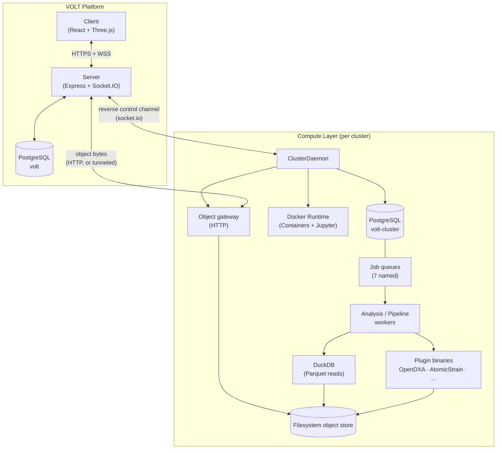
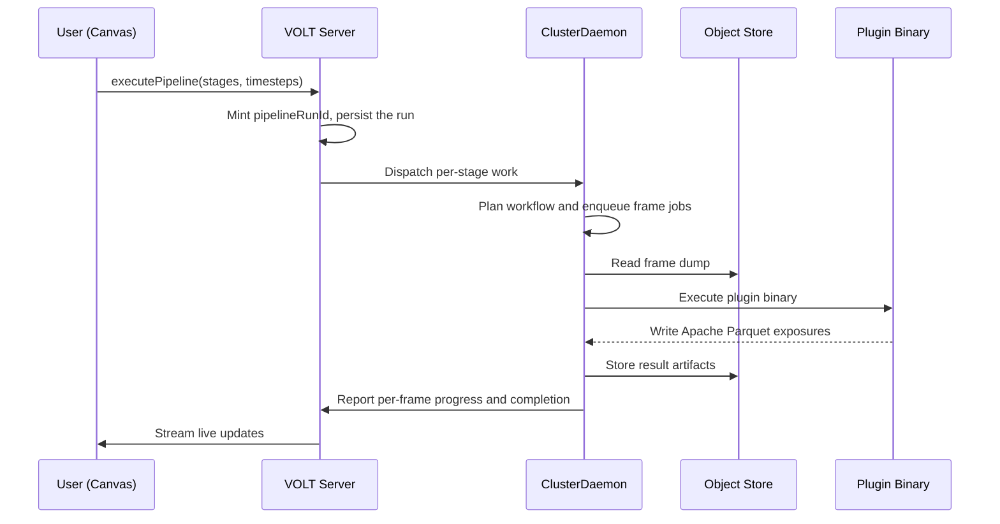

## The mental model

VOLT has three layers:

- the **workspace layer** — the application the team interacts with,
- the **runtime layer** — the daemon on connected machines,
- the **native/tooling layer** — the C++ and SDK ecosystem for parsing, analysis, 3D export, and automation.

Coordination is central; data and execution stay local to team-controlled machines.

## System overview

The native libraries the daemon and the plugin binaries link against — CoreToolkit, LammpsIO, SpatialAssembler, HeadlessRasterizer, VoltSDK — are listed in [Native tooling](#native-tooling-and-open-source-layers) below.

<Callout type="info">
Earlier releases ran MongoDB, Redis, and MinIO alongside the server and on every cluster. All three are gone: metadata moved to **PostgreSQL** (via TypeORM), queues and the event bus are **Postgres-backed**, and object storage is a **filesystem store owned by the daemon** and reached through its object gateway.
</Callout>

## The workspace layer

The main VOLT application — a React client and an Express-based server. It handles authentication, team state, permissions, routes, APIs, and real-time events, and coordinates domain modules: trajectories, analysis, plugins, clusters, containers, scripting, whiteboards, notifications, and AI. It does not store simulation data permanently.

The server owns one PostgreSQL database (`volt`) plus a small data directory (`SERVER_DATA_DIR`) for things it serves itself, such as avatars. Everything heavy — dumps, Parquet exposures, GLB models, rasters — lives on a cluster.

Real-time fan-out uses a **`PostgresEventBus`**: domain events are spooled to the database and broadcast to subscribed server instances, which replaced the Redis pub/sub layer. The same tables back the key-value store used for short-lived runtime state.

## The cluster daemon layer

ClusterDaemon executes operations on cluster infrastructure. It connects outward to VOLT over a reverse control channel, so the cluster needs no inbound HTTP services from VOLT's side. Once connected, it can:

- receive analysis and pipeline requests,
- maintain heartbeats and metrics,
- orchestrate its Postgres-backed job queues,
- parse and preprocess trajectories,
- generate GLB models and preview rasters,
- create Jupyter runtimes,
- serve object bytes through its object gateway,
- proxy container HTTP/WebSocket/TCP ports,
- and coordinate artifacts and exports.

It keeps its own PostgreSQL database (`volt-cluster`, separate from the server's) and its own data directory (`DAEMON_DATA_DIR`), which holds the object store under a configurable `BUCKET_PREFIX`.

### Storage and the object gateway

Object storage is a plain filesystem tree managed by `FilesystemObjectStore`, with buckets created at startup. Reads and writes reach it two ways:

| Path | When it is used |
|---|---|
| **Direct HTTP** | The daemon advertises an object-gateway exposure (`OBJECT_GATEWAY_PUBLIC_BASE_URL`) that the server can reach, so bytes travel over a plain HTTP session pool. |
| **Tunneled** | No direct gateway is reachable, so bytes are reframed onto the daemon's existing socket.io control connection. Correct but slower; a single-host deployment should always take the direct path. |

Analysis output is written as Apache Parquet and queried in place with **DuckDB** (`ParquetTrajectoryFrameStore`), so per-frame reads do not require loading whole files into memory.

### Job queues

Seven named queues run on Postgres, claimed with `FOR UPDATE SKIP LOCKED` so multiple workers can drain one queue safely:

`analysis_processing` · `pipeline_processing` · `artifact_upload` · `plugin_warmup` · `trajectory_frame_processing` · `trajectory_glb_conversion` · `trajectory_rasterization`

Which of these actually start depends on the cluster's effective role, resolved by the `RuntimeRoleCoordinator` from the runtime configuration it fetches after connecting.

## Data flow for analysis

Every analysis — including one started by Volt AI — enters through `executePipeline`. A submission is a **pipeline run** of ordered stages; only `plugin` stages produce an analysis.

A stage whose configuration hash matches an earlier run is served from cache and creates no new analysis — it points at the analysis that already computed it. See [Analysis & Jobs](/docs/modules/analysis) for the stage model.

## Data flow for trajectories

Trajectory handling follows the same layered pattern; the full pipeline is documented in [Trajectories](/docs/modules/trajectories#processing-pipeline).

## Workflow runtime versus plugin binaries

A plugin is a node-based workflow with arguments, context, iteration, exposures, and exports. The runtime resolves it into one or more binary or Python execution steps: the workflow engine handles structural logic around `context`, `forEach`, `arguments`, and branching nodes; the job runtime turns the plan into frame-level work — read inputs, resolve the plugin payload, execute it, process the artifacts. See [Plugin System](/docs/plugins) for node-level details.

## Native tooling and open-source layers

| Tool | Role in the Runtime |
|---|---|
| **CoreToolkit** | Shared C++ foundation used by the scientific plugin binaries |
| **LammpsIO** | Native parsing of LAMMPS-oriented data |
| **SpatialAssembler** | Conversion of structured output into GLB geometry |
| **HeadlessRasterizer** | Rendering of GLB assets into PNG previews |
| **VoltSDK** | Programmatic access for external automation and notebooks |

ClusterDaemon and VoltSDK now live inside the VOLT repository (as `cluster/` and `sdk/`) rather than as separate checkouts, which is why the server image ships the daemon source it installs onto enrolled hosts.

## Networking and operational shape

| Connection | Direction | Why It Exists |
|---|---|---|
| Client to Server | HTTPS and WSS | UI, auth, APIs, and live updates |
| Server to Daemon | Reverse control over WebSocket | Job dispatch, remote operations, cluster lifecycle |
| Server to Object Gateway | HTTP(S), or tunneled over the control channel | Artifact and dump reads/writes |
| Server to PostgreSQL | TCP | Metadata, listings, event spool, key-value state |
| Daemon to PostgreSQL | TCP | Its own metadata and job queues |
| Daemon to Docker | Unix socket | Containers and Jupyter runtimes |

## Bootstrap plane vs control plane

The cluster lifecycle has two phases:

| Phase | Role | Covers |
|---|---|---|
| **Bootstrap plane** | Installs and enrolls the cluster | Install material generation, environment and compose file writing, local service startup, and initial daemon announcement |
| **Control plane** | Keeps it operational after enrollment | Heartbeats, reverse-channel commands, job dispatch, remote access, notebook sessions, exposure registry updates, and lifecycle events through the daemon connection |

The two phases fail independently: a machine may install correctly yet never become a healthy control-plane participant, or it may bootstrap once and later disconnect.

## Daemon startup order

ClusterDaemon starts in this sequence:

1. mount the domain event bridge,
2. mount the command groups onto the reverse-channel bridge, and bind that bridge to the VoltCloud and object-gateway connections,
3. connect local infrastructure — the daemon's PostgreSQL data source and the filesystem object store's buckets, in parallel,
4. start queue maintenance,
5. start the heartbeat plane, and open the event-channel connection (non-blocking: a failure here warns and startup continues),
6. open the cloud control connection, the object-gateway connection, and the local object-gateway HTTP server,
7. publish the daemon's own object-gateway exposure and fetch the runtime configuration,
8. start the exposure registry, then initialize the `RuntimeRoleCoordinator`, which starts the trajectory frame-processing and rasterization workers and — depending on the cluster's effective role — the compute workers (analysis, pipeline, GLB conversion, artifact upload, plugin warmup),
9. publish the first runtime snapshot.

If PostgreSQL, the object-store directory, or Docker are unavailable locally, the daemon fails at step 3 before the cloud side sees a meaningful runtime.

<Callout type="warn">
Command groups, queue workers, and event mapper sets are **explicit lists** under `cluster/src/core/bootstrap/`. They used to be filled by import side effects during a module autoload walk; when that walk was removed each registry silently emptied — commands unreachable, queues that accept jobs but never drain, jobs that run but never report. All three bootstraps now throw on an empty list, and adding a worker or mapper means adding it to its list, not just creating the file.
</Callout>

## Memory-aware runtime behavior

The daemon launcher (`scripts/start.js`) sizes the V8 heap before the process starts: it reads the cgroup limit under Docker (falling back to the host's total RAM) and sets `--max-old-space-size` to roughly 80% of that budget, bounded by a floor and a ceiling. It also injects `--expose-gc` for manual garbage collection. This keeps the heap inside the container's budget and avoids OOM-kills from sizing against host RAM. Set `DAEMON_HEAP_MB` to pin the ceiling on a host that shares its RAM with other workloads.

## Exposure registry and service discovery

The exposure registry inspects managed containers, reads their labels, determines which services should be reachable through VOLT, and periodically publishes snapshots back to the server. Each published exposure carries one of three access modes — HTTP, WebSocket, or TCP — so proxied HTTP services and notebook targets become reachable without manual endpoint registration. The daemon registers its own object gateway as an exposure through the same mechanism.

## Shutdown behavior

On shutdown the daemon:

- shuts down debug sessions,
- stops its compute workers,
- removes its own exposure and stops the exposure registry,
- stops the object-gateway server,
- disconnects the cloud, event-channel, and object-gateway connections,
- stops the heartbeat plane,
- stops queue maintenance and closes the queue service,
- shuts down the plugin process pool,
- releases its local dependencies.

A clean stop looks different from a crash in the logs.

## Failure checklist

When VOLT misbehaves, check:

- cluster connection state,
- PostgreSQL reachability from both the server and the daemon,
- whether object reads are taking the direct gateway path or tunneling,
- daemon memory budget (heap sizing relative to the container's memory limit),
- worker process state — a queue that accepts jobs but drains none points at worker registration,
- and reverse channel liveness.
