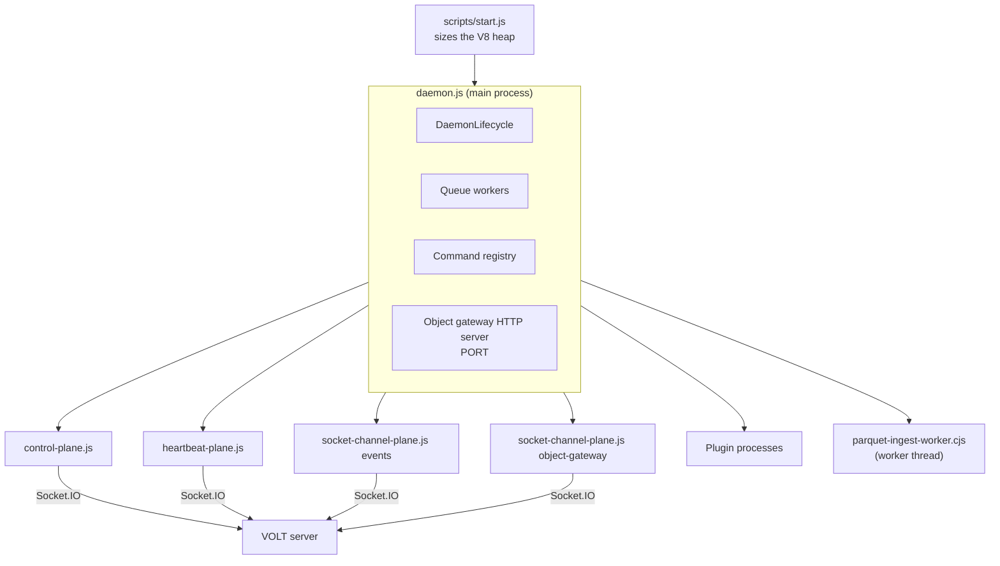

`cluster-daemon` (`packages/infra/cluster`) runs on every machine a team enrolls as a cluster. It keeps the team's data on that machine and does all of VOLT's heavy work there: it ingests and parses trajectories, renders GLB models and preview PNGs, runs analysis plugins, writes Parquet tables, and hosts notebook containers. It connects out to the server, so the machine needs no inbound port for VOLT's control traffic.

The same build runs in the `cluster-daemon` container, as a plain Node process, and in a browser worker under the [web runtime](/docs/architecture/web-runtime).

## Processes

`scripts/start.js` is the launcher (`npm start`, the container's command). It computes a heap size, puts `--max-old-space-size` in `NODE_OPTIONS`, and spawns `dist/infra/cluster/src/daemon.js` (or `tsx src/daemon.ts` with `--dev`), forwarding `SIGTERM`, `SIGINT` and `SIGHUP`.

The main process does the work. Each Socket.IO connection to the server lives in its own child process, a *plane*:

| Plane | Script | Channel | What it carries |
|---|---|---|---|
| Control | `src/control-plane.ts` | `control` | Commands in both directions, each answered by `requestId` (180 s timeout for the daemon's own commands), and tunnels to exposed services |
| Heartbeat | `src/heartbeat-plane.ts` | `heartbeat` | A `runtime-heartbeat` every `TEAM_CLUSTER_HEARTBEAT_INTERVAL_MS` (10 s): metrics, the runtime config, and host capabilities (whether Docker answers, the platform tag). It also sends `HEAD /healthz` to the server every `TEAM_CLUSTER_METRICS_INTERVAL_MS` (3 s) to measure latency. |
| Events | `src/socket-channel-plane.ts events` | `events` | Job and stage status, progress, exposure snapshots, and stream-transported analysis logs, debug logs and scene artifact batches. Up to 8,192 messages are buffered while disconnected. |
| Object gateway | `src/socket-channel-plane.ts object-gateway` | `object-gateway` | Object store requests the server tunnels when it cannot reach the gateway directly |

The planes exist so the reverse channel stays responsive while the main process is saturated by parsing, GLB export or plugin I/O. They talk to the main process over IPC, are restarted by `PlaneProcessSupervisor` when they exit, and run at nice `-5` (`TEAM_CLUSTER_PLANE_PROCESS_PRIORITY`; `off` disables it). Raising priority needs `CAP_SYS_NICE`, which is why the single-host compose stack adds `SYS_NICE` to the `cluster-daemon` container; without it the daemon logs a warning and the planes keep the default priority.

Each plane connects with `transports: ['websocket']`, reconnects forever (0.5 s to 5 s backoff), and on connect emits `team-cluster-daemon:register` with `TEAM_CLUSTER_ID`, `TEAM_CLUSTER_DAEMON_PASSWORD` and its channel name.

## Heap sizing

`scripts/start.js` sizes the heap before Node starts, since a heap sized against the host's RAM gets the container OOM-killed:

- The memory budget is the cgroup limit (`process.constrainedMemory()`) when it is below the host's total RAM, and the host's total RAM otherwise.
- The heap is 80% of that budget, at least 512 MB and at most 262,144 MB.
- `DAEMON_HEAP_MB` replaces the computed value. It must be an integer of at least 512; anything else is ignored with a warning.
- If `NODE_OPTIONS` already has `--max-old-space-size`, the launcher leaves it alone.

The launcher prints the size it chose and why, for example `[start] Setting --max-old-space-size=12800 MB (80% of 16000 MB cgroup limit)`.

## Startup order

`DaemonLifecycle.start()` (`src/core/bootstrap/DaemonLifecycle.ts`):

<Steps>
<Step>
Create the domain event bridge (this mounts the event mapper sets), mount the command groups on the reverse-channel bridge, and bind the bridge to the control connection and the object-gateway connection.
</Step>
<Step>
Connect local infrastructure in parallel: the daemon's database (creating the Postgres database if it does not exist, then synchronizing the schema) and the object store's bucket directories. A failure here stops the daemon before the server sees anything.
</Step>
<Step>
Start queue maintenance.
</Step>
<Step>
Start the heartbeat plane, and start the events channel without waiting for it (a failure only logs a warning).
</Step>
<Step>
Start, in parallel, the control connection, the object-gateway connection and the object gateway HTTP server.
</Step>
<Step>
Register the gateway's own exposure, then fetch the runtime config from the server (`runtime.config.get`).
</Step>
<Step>
Start the exposure registry, and initialize the `RuntimeRoleCoordinator` with the runtime config: it starts the `always` workers, then the `compute` workers if the role runs compute.
</Step>
<Step>
Publish the first runtime snapshot to the heartbeat plane.
</Step>
</Steps>

## Shutdown order

On `SIGTERM` or `SIGINT`, `DaemonLifecycle.stop()`:

1. shuts down plugin debug sessions,
2. stops the compute workers,
3. removes the gateway's exposure and stops the exposure registry,
4. stops the object gateway HTTP server,
5. stops the control, events and object-gateway connections and the heartbeat plane,
6. stops queue maintenance and closes the queue service,
7. shuts down the plugin process pool,
8. disconnects the database.

The process exits with 0 when that completes and 1 if a step throws. An uncaught exception exits with 1 immediately.

## Bootstrap lists

What the daemon registers is listed explicitly under `src/core/bootstrap/`. A new command group, worker or event mapper set does nothing until it is added to its list.

| File | List | Guard |
|---|---|---|
| `command-groups.ts` | `COMMAND_GROUPS`: analysis, debug, pipeline, object-store archive, remote explorer, jobs, notebook, plugin, runtime, trajectory clone, trajectory ingest, trajectory native, trajectory plugin, trajectory queue | A group with no `@Command` methods, or a command name registered twice, throws at startup |
| `workers.ts` | `DAEMON_WORKERS`: the seven queue workers | An empty list throws in `RuntimeRoleCoordinator.initialize` |
| `event-mappers.ts` | `EVENT_MAPPER_SETS`: runtime, analysis, exposure, plugin, trajectory | An empty list throws when the event bridge mounts |
| `entities.ts` | The daemon's TypeORM entities: `queue_jobs`, `daemon_state_entries`, `daemon_state_list_items`, `plugin_listing_rows`, `plugin_sub_listing_rows` | |

The commands themselves are named in `packages/shared/contracts/src/modules/cluster/daemon-commands.ts`:

| Group | Commands |
|---|---|
| Pipelines and analyses | `pipeline.start`, `analysis.start`, `analysis.cleanup-runtime-state` |
| Plugin debugger | `debug.start`, `debug.step`, `debug.continue`, `debug.stop` |
| Plugins | `plugin.sync`, `plugin.warmup`, `plugin.registry.install`, `plugin.listings.list`, `plugin.sub-listings.list`, `plugin.transfer.listings.export` / `import` / `purge` |
| Trajectories | `trajectory.ingest`, `trajectory.clone`, `trajectory.enqueue-preprocessing`, `trajectory.cleanup-runtime-state`, `trajectory.native.*` (metadata, atoms, property stats, unique values, filter previews, color and particle-filter models), `trajectory.plugin.*` (exposure property names, schema, atom index, modifier stats and unique values) |
| Jobs | `jobs.retry`, `jobs.remove-running` |
| Notebooks | `notebook.session.create`, `notebook.container.delete` |
| Runtime | `runtime.role.apply`, `runtime.queue-concurrency.apply`, `runtime.queues.snapshot`, `runtime.uninstall` |
| Storage | `object-store.archive.create`, `remote.explorer.list`, `remote.explorer.node`, `remote.explorer.download` |

The server starts every analysis with `pipeline.start`. `analysis.start` feeds the `analysis_processing` queue directly with single-plugin jobs.

## Job queues

The queues live in the daemon's own database, table `queue_jobs`, so jobs survive restarts and need no broker.

| Queue | Worker | Scope | Concurrency key (default) | Fed by |
|---|---|---|---|---|
| `trajectory_frame_processing` | `TrajectoryFrameProcessingWorker` | always | `glbPreprocessing` (16) | `trajectory.ingest`, one job per frame |
| `trajectory_rasterization` | `TrajectoryRasterWorker` | always | `rasterizer` (8) | Frame processing and GLB conversion (the automatic preview) |
| `trajectory_glb_conversion` | `TrajectoryGlbWorker` | compute | `glbPreprocessing` (16) | `trajectory.enqueue-preprocessing` |
| `pipeline_processing` | `PipelineWorker` | compute | `analysis` (8) | `pipeline.start`, one job per timestep |
| `analysis_processing` | `AnalysisWorker` | compute | `analysis` (8) | `analysis.start` |
| `artifact_upload` | `ArtifactUploadWorker` | compute | `artifactUpload` (16) | Pipeline and analysis jobs, after a plugin stage |
| `plugin_warmup` | `PluginWarmupWorker` | compute | `pluginWarmup` (4) | `plugin.warmup` |

The defaults come from `@voltstack/daemon-cluster-client`; the runtime config the server sends (stored on the cluster) overrides them, and `runtime.queue-concurrency.apply` changes them live. Queue scope limits (`maxRunningPerTrajectory`, 0 meaning unlimited) cap how many jobs of one trajectory run at once.

How a job moves:

- **Enqueue.** A row in `waiting` state. The enqueuer then notifies workers: `pg_notify('volt_queue_jobs', queue)` on Postgres, an in-process notifier on SQLite. Workers also poll every `QUEUE_WORKER_POLL_INTERVAL_MS` (2 s).
- **Claim.** A worker slot takes the oldest due job of its queue in one statement. On Postgres the candidate row is selected `FOR UPDATE SKIP LOCKED`, so any number of workers drain a queue without taking the same job; on SQLite a single `UPDATE ... WHERE id = (SELECT ... LIMIT 1) RETURNING *` does the same. The claim sets `state = 'active'`, increments `attemptsMade`, and writes a lease (`lockedBy`, `lockedUntil`).
- **Lease.** The lease lasts `QUEUE_WORKER_LOCK_DURATION_MS` (1 hour) and is renewed while the job runs.
- **Failure.** A failed job with attempts left becomes `delayed` with a fixed or exponential backoff; otherwise it is `failed`.
- **Maintenance.** Every `QUEUE_MAINTENANCE_INTERVAL_MS` (60 s), `QueueMaintenance` puts jobs whose lease lapsed back in `waiting` (a job that stalls a second time fails), purges expired finished jobs, and sweeps expired daemon state.

## Runtime roles

A cluster's role decides which workers run. The server stores it with the cluster and sends it in the runtime config; `runtime.role.apply` changes it live.

| Role | Stores data | Runs compute |
|---|---|---|
| `cluster` (default) | Yes | Yes |
| `storage-server` | Yes | No |
| `compute-node` | No | Yes |

`RuntimeRoleCoordinator` (`src/core/bootstrap/RuntimeRoleCoordinator.ts`) always starts the `always` workers, which keep the trajectories a machine stores processed. It starts the `compute` workers unless the role is `storage-server`, and stops them (waiting for running jobs) when the role changes away from compute. On the server side, the role decides where uploads land (clusters that accept storage writes) and where pipelines run (clusters that accept compute jobs).

## Plugin execution

### Getting the binary

Plugin binaries live in the `volt-plugins` bucket. A plugin installed from the registry is stored under `plugin-binaries/registry/<scope>/<version>/<platform>/<file>`: `plugin.registry.install` downloads the tarball, checks its SHA-256, extracts it (zstd or gzip tar), reads its workflow, and stores either the executable or the Python project zipped. Before a run, the server sends `plugin.sync` to the compute cluster, which checks that it can read the binary from the cluster that owns it. `PluginBinaryCache` downloads the binary when a job needs it and keeps local copies and provisioned environments in `DAEMON_DATA_DIR/plugin-bin-cache`.

The platform tag comes from `currentPlatformTag()` (`src/shared/utilities/platform-tag.ts`): `<system>-<machine>` such as `linux-x86_64`, `darwin-arm64` or `windows-x86_64`, and `wasm-wasm32` in the web runtime. The heartbeat reports it, and the server asks the registry for that platform's bundle.

### Native executables

An executable entrypoint runs as a one-shot child process per invocation (`BinaryExecutorService.executeProcess`). If it exceeds `PLUGIN_PROCESS_EXECUTION_TIMEOUT_MS` or prints nothing for `PLUGIN_PROCESS_STALL_TIMEOUT_MS` (both 0, meaning no limit, by default), it is killed and run again, up to `PLUGIN_PROCESS_MAX_ATTEMPTS` (3) times.

Every plugin process gets a thread count in `OMP_NUM_THREADS`, `OPENBLAS_NUM_THREADS`, `MKL_NUM_THREADS` and the like, unless already set: `PLUGIN_PROCESS_DEFAULT_NATIVE_THREADS`, else `PLUGIN_PROCESS_NATIVE_THREAD_BUDGET`, else the CPUs minus one split across the concurrent plugin processes (at least 2). It also gets `VOLT_DUCKDB_MEMORY_LIMIT_MB` for the DuckDB the plugin writes its tables with (25% of RAM, between 1 GB and 16 GB, unless set).

### Python plugins

A Python plugin is provisioned like a project: a virtual environment, `pip install -r requirements.txt` (plus what the host stub needs), and a marker file so it installs once. `plugin.warmup` queues that work ahead of time on `plugin_warmup` and publishes the result as a *warm image*, `plugins/warm/<binaryHash>.warm.tar.zst` in `volt-plugins`, which later runs restore instead of installing again.

A Python script entrypoint runs in a persistent host rather than a fresh process per frame. `PluginProcessPool` keeps `volt_plugin_stub.py` processes per plugin. The stub imports the plugin module and answers requests framed as `[u32 opId][u32 length][JSON]` on stdin and stdout by calling `process(frame, config)` or `process_batch(frames, config)`. Frame columns arrive as memory-mapped bindings, exposed as zero-copy NumPy arrays when NumPy is installed.

| Setting | Default |
|---|---|
| `PLUGIN_PROCESS_POOL_MAX` | CPUs minus one |
| `PLUGIN_PROCESS_POOL_MAX_MEMORY_MB` | 70% of RAM |
| `PLUGIN_PROCESS_EST_MEMORY_MB` | 1024; the pool never runs more processes than budget divided by estimate |
| `PLUGIN_PROCESS_POOL_MIN_IDLE` | 1 |
| `PLUGIN_PROCESS_READY_GRACE_MS` | 120,000 |

### Inside a pipeline job

A `pipeline_processing` job is one timestep of a pipeline run. `processPipelineJob` downloads `timestep-<N>.dump.zst` from the storage cluster into a working dump, then runs the stages in order:

| Stage | What runs |
|---|---|
| `slice` | `volt-dump-transform <dump> <dump> --slice nx,ny,nz,distance,reverse` |
| `expression` | `volt-dump-transform <dump> <dump> --select "<expr>"` |
| `plugin`, computed | The plugin's workflow (`WorkflowRuntime`), whose entrypoints write Parquet exposures; the exposures are merged into the working dump with `--merge` so later stages see their properties, and an `artifact_upload` batch exports and uploads the results |
| `plugin`, cache hit | No plugin run: the earlier analysis's shared exposures are fetched from the storage cluster, and its saved working dump (or its atom exposures, merged) replaces the working dump |

`volt-dump-transform` is found in `vendor/volt-dump-transform/bin`, or at `VOLT_DUMP_TRANSFORM_BIN`. Artifacts (Parquet exposures, GLB models, charts, listing rows) are written to the trajectory's storage cluster, which may be another machine.

## Trajectory processing

`trajectory.ingest` runs on the storage cluster when an upload is committed:

1. Check that every declared part was uploaded with the declared size, and compose multi-part files into one object.
2. Expand ZIP archives (skipping `__MACOSX`, `.DS_Store`, `Thumbs.db`).
3. Scan each file with LammpsIO (`scanFrames`, `readHeader`). A file with several frames is split into one object per frame by byte range.
4. Drop duplicate timesteps and enqueue one `trajectory_frame_processing` job per frame (`TRAJECTORY_FRAME_JOB_ATTEMPTS`, 3, with `TRAJECTORY_FRAME_JOB_BACKOFF_MS`, 2,000). Up to `TRAJECTORY_INGEST_CONCURRENCY` (8) files are handled at once.
5. Return the frames and stats to the server.

Each frame job then:

1. compresses the dump with `zstd -5` (`TRAJECTORY_ZSTD_THREADS` threads, 2 by default) to `volt-dumps/trajectory-<id>/timestep-<N>.dump.zst`,
2. reads the frame with LammpsIO's `readFrame`, writes a GLB with SpatialAssembler's `generateGLBToFile`, compresses it with zstd, and stores it as `volt-models/trajectory-<id>/timestep-<N>.glb.zst` (`Content-Encoding: zstd`),
3. removes the staged upload and queues a `trajectory_rasterization` job for the frame's preview,
4. checks whether every frame of the trajectory has settled. The worker that finds all of them done takes a claim in daemon state and ingests every frame into `volt-trajectories/trajectory-<id>/trajectory.parquet` plus `elements.json`, using LammpsIO and DuckDB in `parquet-ingest-worker.cjs`, a worker thread.

The raster job decompresses the GLB and renders it with HeadlessRasterizer's `rasterize` (azimuth 45°, elevation 25°, field of view 45°, Z up) to `volt-rasterizer/trajectory-<id>/previews/timestep-<N>.png`.

`zstd` is the binary in `vendor/zstd/bin`, or `VOLT_ZSTD_BIN`. `trajectory.enqueue-preprocessing` regenerates frame GLBs on the `trajectory_glb_conversion` queue.

## Notebooks runtime

On a machine with Docker, `notebook.session.create` gives each notebook a Jupyter container (`JupyterRuntime`, `src/modules/notebook/services/JupyterRuntime.ts`):

- The image is `JUPYTER_IMAGE` (`ghcr.io/voltlabs-research/volt-jupyter-scripting:main`), listening on `JUPYTER_PORT` (8888) with `JUPYTER_TOKEN`.
- The container gets the notebook's ids, team, server URL and secret key as `VOLT_*` environment variables, and labels that declare its HTTP and WebSocket port and a readiness probe.
- An existing container is reused, started if stopped, or recreated if its configuration changed. The notebook's content is copied in under `JUPYTER_NOTEBOOK_ROOT`.
- `notebook.container.delete` removes it.

The server reaches the container through its exposure (below). In the web runtime there is no Docker; the client runs kernels in the page instead (see [Web runtime](/docs/architecture/web-runtime#python-and-notebooks)).

## Exposure registry

`DaemonExposureRegistry` tells the server which services on the machine it can reach. Every 5 s it lists the containers labeled `volt.managed=true` (every container the daemon creates carries it), reads `volt.exposure.http.ports` and `volt.exposure.websocket.ports`, applies readiness probes, adds the daemon's own `daemon:object-gateway` exposure, and sends a snapshot on the `events` channel when anything changed or after a reconnect. Each exposure has a target host and port and its access modes (`http`, `websocket`, `tcp`).

## Object gateway

The daemon's HTTP server (`ObjectGatewayServer`, on `HOST`:`PORT`, default `0.0.0.0:8080`) serves the object store at `/internal/object-gateway/v1/buckets/:bucket/objects`: list, get (with ranges), head, put, delete, delete by prefix, and compose. Every request needs a direct-access JWT in `x-team-cluster-direct-access-token`, signed by the server with the daemon password, whose claims name this cluster and the `daemon:object-gateway` exposure.

If `OBJECT_GATEWAY_PUBLIC_BASE_URL` is set, the exposure carries it as `volt.exposure.base-url` and the server sends requests there directly. Otherwise the server tunnels the same requests over the `object-gateway` channel. See [Object bytes: direct or tunneled](/docs/architecture/server#object-bytes-direct-or-tunneled).

## Configuration

| Variable | Default | Purpose |
|---|---|---|
| `TEAM_CLUSTER_ID`, `TEAM_CLUSTER_DAEMON_PASSWORD` | required | The cluster's identity and secret |
| `VOLT_CLOUD_URL` | required | The server's URL |
| `TEAM_ID` | | The team, used in the exposures it publishes |
| `DATABASE_URL` | `sqlite:$DAEMON_DATA_DIR/daemon.sqlite` | `postgres://...` or `sqlite:<path>` |
| `DAEMON_DATA_DIR` | `~/.volt-daemon/data` | Data and caches (see [Data & storage](/docs/architecture/storage#daemon-data-directory)) |
| `OBJECT_STORE_ROOT` | `$DAEMON_DATA_DIR/object-store` | The object store's root |
| `BUCKET_PREFIX` | empty | Prefix of the bucket directories (`cluster-` in the compose stack) |
| `HOST`, `PORT` | `0.0.0.0`, `8080` | The object gateway's listen address |
| `OBJECT_GATEWAY_PUBLIC_BASE_URL` | | The URL the server can reach the gateway at |
| `DAEMON_HEAP_MB` | 80% of the memory budget | V8 heap size |

The full list, with ports and volumes, is in [Configuration](/docs/run/configuration).

## Vendor tools

The daemon shells out to two programs it keeps in `vendor/`:

| Tool | Source | Installed by |
|---|---|---|
| `volt-dump-transform` | CoreToolkit's GitHub release pinned in `package.json` (`"coreToolkitTools": { "repository": "VoltLabs-Research/CoreToolkit", "release": "v2.6.1" }`) | `scripts/fetch-dump-transform.mjs` |
| `zstd` | The system's `zstd`; on Windows, the `facebook/zstd` release pinned as `"voltZstd": { "release": "v1.5.7" }` | `scripts/fetch-zstd.mjs` |

Both scripts run in `build`, `predev` and `fetch:tools`. `scripts/coretoolkit-tool.mjs` downloads `<tool>-<platform>.tar.gz` and its `.sha256` from the release, checks the hash, caches the archive in `~/.cache/<tool>/<release>`, and extracts it into `vendor/<tool>/bin`. `VOLT_DUMP_TRANSFORM_BIN` uses a local build instead, `VOLT_DUMP_TRANSFORM_PLATFORM` picks another platform's asset, and `VOLT_DUMP_TRANSFORM_SKIP_FETCH=1` skips the download. The web runtime installs the `wasm-wasm32` builds of both tools from the same release (see [Building](/docs/architecture/web-runtime#building)).
