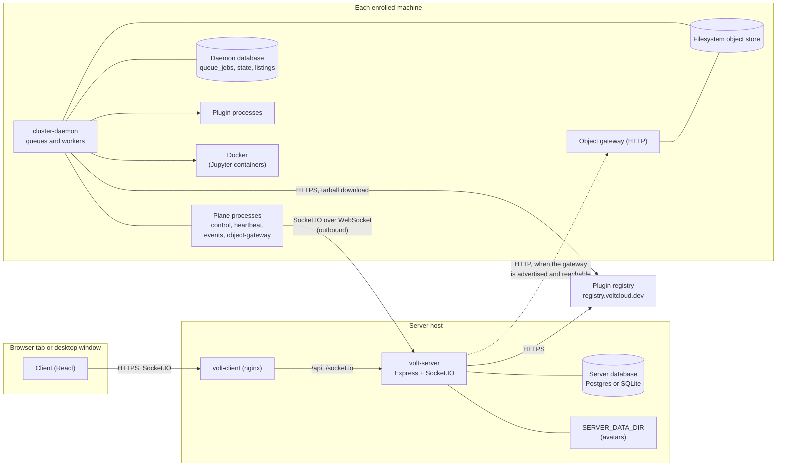
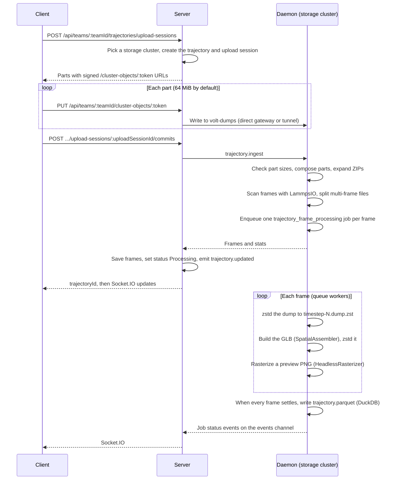
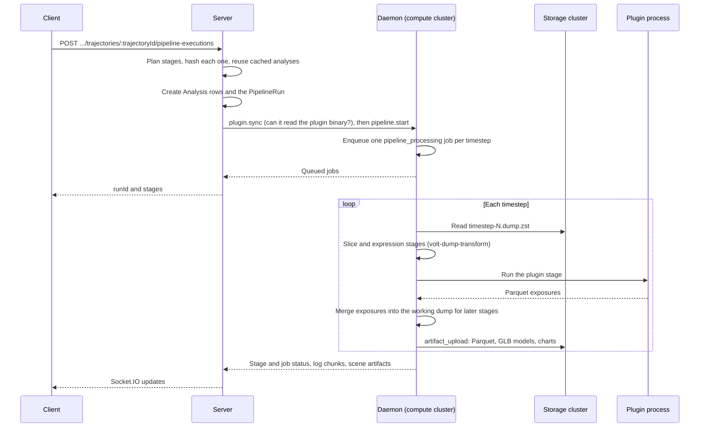

VOLT is four kinds of programs:

- **The client** (`packages/apps/client`, `volt-webapp`): the React web app, with a three.js canvas, that people use. It talks to one server over HTTP and Socket.IO.
- **The server** (`packages/infra/server`, `volt-server`): an Express + Socket.IO API. It owns accounts, teams, permissions, the metadata of every trajectory and analysis, and the real-time fan-out to clients. It holds no simulation data.
- **The cluster daemon** (`packages/infra/cluster`, `cluster-daemon`): one per machine a team enrolls (a *cluster*). It stores the team's data on that machine and does the computing: parsing trajectories, rendering models and previews, running plugins, hosting notebook containers.
- **Plugins and native libraries**: the analysis programs the daemon runs (C++ executables built on [CoreToolkit](/docs/architecture/libraries#coretoolkit), or Python projects), and the Node addons the daemon loads to read dumps, build GLB models and rasterize previews.

The split keeps data and compute on machines the team controls. The daemon dials out to the server, so a cluster needs no inbound port; the server coordinates and relays.

## Components

The pieces, and where each is documented:

<Cards>
  <Card title="Server" href="/docs/architecture/server" description="Modules, HTTP and Socket.IO, auth and RBAC, the database, the event bus, and how it reaches daemons." />
  <Card title="Cluster daemon" href="/docs/architecture/cluster-daemon" description="Planes, startup order, queues, workers, plugin execution, trajectory processing and the object gateway." />
  <Card title="Web runtime" href="/docs/architecture/web-runtime" description="The server and daemon running unmodified in browser workers, for the browser and the desktop app." />
  <Card title="Data & storage" href="/docs/architecture/storage" description="Where every kind of data lives: databases, buckets, caches, volumes and OPFS." />
  <Card title="Native libraries" href="/docs/architecture/libraries" description="CoreToolkit, LammpsIO, SpatialAssembler and HeadlessRasterizer." />
</Cards>

## One set of programs, three ways to run

The server and the daemon are the same programs wherever VOLT runs. What changes is the host underneath them.

| | Self-hosted | Browser tab | Desktop app |
|---|---|---|---|
| Where the server and daemon run | Node processes, normally the containers of `packages/apps/desktop/stack/compose.yml` (`volt-postgres`, `volt-server`, `volt-client`, `cluster-daemon`), plus a daemon on every enrolled machine | Module workers of the page, on [`@volt/web-runtime`](/docs/architecture/web-runtime) | The same workers, in the Electron window that serves the client at `https://volt.invalid` |
| Server database | Postgres (`DATABASE_URL=postgres://...`) | SQLite (sqlite-wasm) in the origin private file system (OPFS) | Same as the browser |
| Daemon database | Postgres (`volt-cluster`), or SQLite when `DATABASE_URL` is unset | SQLite in OPFS | Same as the browser |
| Object store | `DAEMON_DATA_DIR/object-store` on the machine's disk | OPFS | OPFS of the app's persistent session |
| Plugins | Native builds for the machine's platform (`linux-x86_64`, `darwin-arm64`, `windows-x86_64`) | `wasm-wasm32` builds, run as Node programs in workers | Same as the browser |
| Notebook kernels | Jupyter containers on a cluster with Docker | Python (Pyodide) processes in the page | Same as the browser |
| `DEPLOYMENT_MODE` | `cloud` when deployed with the deploy CLI; the compose file defaults to `local` | `local` | `local` |

A browser runs its own stack when local-stack mode is on (the client stores `volt:backend:local-stack` in `localStorage`); the desktop app always does, since its preload exposes `window.volt`. Only one tab of an origin runs the stack. See [Run in the browser](/docs/run/browser), [Desktop app](/docs/run/desktop) and [Self-hosting](/docs/run/self-hosting) for how to start each.

## Networking

Every connection, from the side that opens it:

| From | To | Protocol | What travels |
|---|---|---|---|
| Browser | Client host | HTTP(S) | The static client bundle. The `volt-client` image is nginx, which also proxies `/api` and `/socket.io` to `volt-server` on the same origin. |
| Client | Server | HTTPS, Socket.IO (long-polling, upgraded to WebSocket) | REST API under `/api`, live events, uploads and downloads under `/api/teams/:teamId/cluster-objects/:token`. |
| Daemon (plane processes) | Server | Socket.IO over WebSocket, outbound only | Four connections, one per channel: `control` (commands both ways), `heartbeat`, `events`, `object-gateway` (tunneled object bytes). |
| Daemon (heartbeat plane) | Server | HTTP `HEAD /healthz` | Latency probe reported with each heartbeat. |
| Daemon | Server | HTTP, `/internal/team-cluster/object-store/v1/...` | Reads and writes of objects owned by another cluster, authenticated with the cluster id and daemon password headers. |
| Server | Daemon object gateway | HTTP, `/internal/object-gateway/v1/buckets/:bucket/objects` | Object bytes, when the daemon advertises `OBJECT_GATEWAY_PUBLIC_BASE_URL` and the server can reach it. Otherwise the same requests tunnel over the `object-gateway` channel. |
| Server | Server database | TCP (Postgres) or file (SQLite) | Metadata, key-value state, and `LISTEN`/`NOTIFY` for the event bus on Postgres. |
| Daemon | Daemon database | TCP (Postgres) or file (SQLite) | Job queues, daemon state, analysis listing rows. |
| Server | Plugin registry (`REGISTRY_URL`) | HTTPS | Package search and tarball resolution. |
| Daemon | Plugin registry | HTTPS | The plugin tarball the server resolved, verified against its SHA-256. |
| Daemon | Docker | Unix socket `/var/run/docker.sock` | Jupyter containers, and the container scan that feeds the exposure registry. |
| Server | Jupyter container | HTTP and WebSocket, relayed over the daemon's `control` channel | Notebook UI and kernels under `/api/jupyter`. |

In the browser and the desktop app, the same connections run over the web runtime's loopback network between workers, and the page's service worker relays the client's `/api` and `/socket.io` requests to the server worker.

## Deployment modes

`DEPLOYMENT_MODE` is read by the server and exposed at `GET /api/system/config` as `{ "mode": "local" | "cloud" }`. Any value other than `local` means `cloud`.

| | `local` | `cloud` |
|---|---|---|
| Who it is for | One person on one machine: the browser runtime, the desktop app, a bare compose stack | A shared server with many accounts and teams |
| Sign-in | `POST /api/auth/sessions/local` signs in as the provisioned local account (`local@volt.local`) without a password; the client does it automatically | Email and password or OAuth. The local sign-in route answers 404. |
| Client navigation | Hides the multi-tenant pages (**Authentication**, **Sessions**, **My Team**, **Manage Roles**) | Shows everything |

The local account, its team and its cluster are created by `@volt/local-stack` (`packages/shared/local-stack`) the first time a local stack starts. The self-hosting CLI reuses the same bootstrap for the stack it deploys.

## Lifecycle of a trajectory upload

Uploads go through the server to the trajectory's storage cluster in parts, and the daemon on that cluster does all of the parsing.

Part size is `TRAJECTORY_UPLOAD_CHUNK_SIZE`, and the signed URLs are valid for `TRAJECTORY_UPLOAD_SESSION_TTL_SECONDS` (6 hours by default). The steps on the daemon are described in [Trajectory processing](/docs/architecture/cluster-daemon#trajectory-processing).

## Lifecycle of an analysis

Every analysis the server starts, from the canvas, the SDKs or VOLT AI, is a stage of a pipeline run. The compute cluster that runs it can differ from the storage cluster that holds the trajectory.

A plugin stage whose hash matches an earlier analysis is a cache hit: it creates no analysis and points at the one that already computed it. See [Pipelines & analyses](/docs/guides/pipelines) for the user's view, and [Plugin execution](/docs/architecture/cluster-daemon#plugin-execution) for what the daemon does with a stage.
