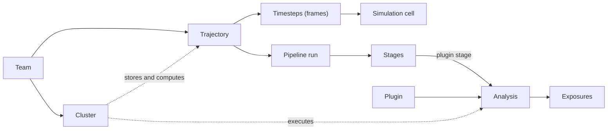

Most of VOLT reads naturally once you know a dozen words. This page defines them and shows how they connect.

## Workspace

**Team.** The workspace everything belongs to: trajectories, clusters, plugins, notebooks, whiteboards, AI conversations, secret keys and roles. Switching teams swaps the whole workspace. Members get a role, and the role's permissions decide what they can see and change. See [Teams](/docs/guides/teams).

**Cluster.** A machine enrolled into a team that stores the team's data and runs its work: trajectory processing, analyses and notebooks. A team needs at least one connected cluster. In the browser and the desktop app the cluster is your own tab or window; on a server you enroll workstations, servers or HPC nodes. See [Clusters](/docs/guides/clusters).

**Deployment mode.** A server runs in `cloud` mode (accounts, sign-up, teams, invitations) or in `local` mode (one local account, signed in automatically), which is what the browser and the desktop app use. See [Configuration](/docs/run/configuration#deployment-modes).

## Data

**Trajectory.** One simulation as VOLT keeps it: the files you uploaded, split into frames, with the metadata, previews and 3D models derived from them. See [Trajectories](/docs/guides/trajectories).

**Timestep.** One frame of a trajectory, identified by the simulation timestep it was written at. Analyses run per timestep, and you choose which timesteps a pipeline covers.

**Simulation cell.** The box of a frame: its cell vectors, origin and periodic boundary conditions. VOLT extracts it from every frame. See [Simulation cells](/docs/guides/simulation-cells).

## Analysis

**Plugin.** A packaged analysis algorithm, published to the plugin registry and installed into a team. A plugin is a workflow: its arguments, the program it runs on each frame, and the results it exposes. See the [plugin catalog](/docs/plugins) and [Writing plugins](/docs/develop/plugins).

**Pipeline.** An ordered list of stages you build in the canvas. Its **modifications** are the stages: plugin analyses, slice planes and expression selections, which the cluster applies in order so each one sees what the previous left, plus color coding, which only changes what you see. Its **visual elements** decide what is drawn. See [Pipelines & analyses](/docs/guides/pipelines).

**Pipeline run.** One execution of a pipeline over the timesteps you picked. A run keeps its stages and timesteps, so you can reopen it, extend it with new stages, or run it again with changed parameters.

**Analysis.** The result of one plugin stage of a run: the plugin, its arguments, its status and per-frame progress, and its outputs. A stage that matches one already computed reuses that analysis instead of computing it again.

**Exposure.** One named output of an analysis, such as a structure classification or a set of dislocation lines. It can hold tables, per-atom properties and 3D models, stored on the cluster as Parquet tables and compressed GLB models, and read back as listings, columns of the atoms or layers in the scene. See [Analysis results](/docs/guides/results).

**Job.** One unit of work on a cluster's queue, such as processing one frame of a trajectory or running one frame of an analysis. See [Jobs](/docs/guides/jobs).

## Programmatic access

**Secret key.** A team credential for programs: the SDKs, scripts and notebooks. A key carries a role, so it can do exactly what that role allows. See [Secret keys](/docs/guides/secret-keys).

**Notebook.** A Python notebook whose kernel runs on one of the team's clusters (in the page, for the browser and desktop runtimes), with the `voltsdk` client already authenticated. A notebook is general, or linked to one trajectory. See [Notebooks](/docs/guides/notebooks).
