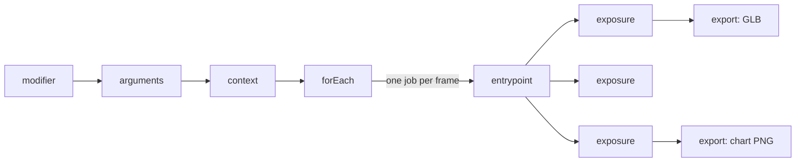

A VOLT plugin is a program that analyzes one trajectory frame and writes result files, plus a `plugin.json` that describes it as a workflow of nodes: its metadata, the arguments users set, how it is run, and which of its files VOLT should read. The cluster daemon runs the program once per frame and turns its files into listings, per-atom properties, 3D models and charts.

Plugins are usually C++ programs built on [CoreToolkit](https://github.com/VoltLabs-Research/CoreToolkit), or Python modules. This page builds one of each, then documents every part of the format. For using plugins in the app, see [Plugins](/docs/guides/plugins); for the CLI that publishes them, see [VPM](/docs/develop/vpm).

## How a plugin runs

A workflow has two segments. The **planning** nodes (`modifier`, `arguments`, `context`, `forEach`) run once when an analysis starts: they resolve the arguments and list the frames to analyze. The `forEach` node turns that list into one job per frame. Each job runs the **runtime** nodes on its frame: the `entrypoint` runs your program, each `exposure` reads one of its output files, and an `export` turns an exposure into an artifact such as a GLB model or a chart.



In each job the daemon:

1. downloads the frame's dump to a local file;
2. resolves the entrypoint's argument template and runs the program, or calls the Python module;
3. for each exposure, reads `<output base>_<results>` and stores its listing rows, sub-listings and per-atom properties;
4. for each export, builds the artifact from the exposure's file and uploads it.

Analyses run as stages of a pipeline (see [Pipelines & analyses](/docs/guides/pipelines)). A stage's input is the pipeline's working dump for that frame: after a stage, an `annotated.dump` it wrote replaces the working dump, and otherwise its `atoms.parquet` files are merged into it as new columns. So a plugin later in a pipeline sees the columns earlier stages added.

## A complete Python plugin

This plugin splits the atoms of each frame into equal bands along z. It writes a per-atom table that colors the 3D model by band, a listing with a row per frame and a sub-listing per band, and a bar chart.

<Files>
  <Folder name="z-bands" defaultOpen>
    <File name="plugin.json" />
    <File name="vpm.json" />
    <File name="requirements.txt" />
    <Folder name="scripts" defaultOpen>
      <File name="z_bands.py" />
    </Folder>
  </Folder>
</Files>

### The module

The daemon runs Python plugins in a persistent host process. The host imports the module named by the entrypoint's `entrypointScript` and calls `process(frame, config)` for each frame. `config['args']` holds the argument list a C++ program would get on its command line, so the module parses it with `argparse`.

```python title="scripts/z_bands.py"
"""Z Bands: splits the atoms of a frame into equal bands along z and counts each band.

VOLT imports this module in its persistent Python host and calls process(frame, config)
once per frame. Standard output carries the host's protocol, so every log line goes to
standard error.
"""

import argparse
import json
import sys

import numpy as np
import pandas as pd


def log(message):
    print(message, file=sys.stderr, flush=True)


def parse_args(argv):
    parser = argparse.ArgumentParser(prog='z-bands')
    parser.add_argument('input_path')
    parser.add_argument('output_base')
    parser.add_argument('--bands', type=int, default=4)
    args, _unknown = parser.parse_known_args(argv)
    return args


def write_payload(path, document):
    pd.DataFrame({'payload': [json.dumps(document)]}).to_parquet(path, index=False)


def process(frame, config):
    args = parse_args(config['args'])
    if args.bands < 1:
        raise ValueError('--bands must be at least 1')

    positions = np.asarray(frame['positions'], dtype=np.float64)
    natoms = len(positions)
    ids = frame.get('ids')
    ids = np.asarray(ids, dtype=np.uint64) if ids is not None else np.arange(1, natoms + 1, dtype=np.uint64)
    log(f'Parameters: bands={args.bands}')
    log(f'Frame {frame["timestep"]}: {natoms} atoms')

    z = positions[:, 2]
    z_min, z_max = float(z.min()), float(z.max())
    width = (z_max - z_min) / args.bands or 1.0
    band = np.minimum(((z - z_min) / width).astype(np.int32), args.bands - 1)
    labels = np.array([f'Band {index + 1}' for index in range(args.bands)])

    pd.DataFrame({
        'atom_index': np.arange(natoms, dtype=np.uint32),
        'id': ids,
        'x': positions[:, 0],
        'y': positions[:, 1],
        'z': z,
        'bucket': labels[band],
        'z_band': band + 1,
    }).to_parquet(f'{args.output_base}_atoms.parquet', index=False)

    counts = np.bincount(band, minlength=args.bands)
    rows = [
        {'band': int(index + 1), 'z_from': z_min + index * width, 'z_to': z_min + (index + 1) * width, 'atoms': int(count)}
        for index, count in enumerate(counts)
    ]
    write_payload(f'{args.output_base}_z_bands.parquet', {
        'main_listing': {'total_atoms': natoms, 'bands': args.bands, 'z_min': z_min, 'z_max': z_max},
        'sub_listings': {'bands': rows},
    })
    write_payload(f'{args.output_base}_z_bands_chart.parquet', {
        'export': {'ChartExporter': {'bands': {
            'band': [labels[row['band'] - 1] for row in rows],
            'atoms': [row['atoms'] for row in rows],
        }}},
    })

    log(f'Wrote {args.bands} bands to {args.output_base}_*.parquet')
    return {'bands': args.bands}
```

### The workflow

```json title="plugin.json"
{
  "workflow": {
    "nodes": [
      {
        "id": "plugin-metadata",
        "type": "modifier",
        "position": { "x": 0, "y": 0 },
        "data": {
          "modifier": {
            "key": "z-bands",
            "name": "Z Bands",
            "version": "1.0.0",
            "author": "Your Name",
            "license": "MIT",
            "description": "Splits the atoms into equal bands along z and counts each band."
          }
        }
      },
      {
        "id": "plugin-arguments",
        "type": "arguments",
        "position": { "x": 280, "y": 0 },
        "data": {
          "arguments": {
            "arguments": [
              { "argument": "bands", "type": "number", "label": "Bands", "default": 4, "min": 1, "step": 1 }
            ]
          }
        }
      },
      {
        "id": "trajectory-context",
        "type": "context",
        "position": { "x": 560, "y": 0 },
        "data": { "context": { "source": "trajectory_dumps" } }
      },
      {
        "id": "foreach-frame",
        "type": "forEach",
        "position": { "x": 840, "y": 0 },
        "data": { "forEach": { "iterableSource": "{{ trajectory-context.trajectory_dumps }}" } }
      },
      {
        "id": "analysis-entrypoint",
        "type": "entrypoint",
        "position": { "x": 1120, "y": 0 },
        "data": {
          "entrypoint": {
            "type": "python-script",
            "binary": "z-bands-plugin.zip",
            "binaryFileName": "z-bands-plugin.zip",
            "entrypointScript": "scripts/z_bands.py",
            "requirementsFile": "numpy\npandas\npyarrow",
            "arguments": "{{ foreach-frame.currentValue.path }} {{ foreach-frame.outputPath }} {{ plugin-arguments.as_str }}"
          }
        }
      },
      {
        "id": "bands-model-exposure",
        "type": "exposure",
        "position": { "x": 1400, "y": -120 },
        "data": {
          "exposure": {
            "name": "Z Bands Model",
            "results": "atoms.parquet",
            "hasListing": false,
            "properties": [{ "key": "z_band", "label": "Z band", "type": "int" }]
          }
        }
      },
      {
        "id": "bands-model-export",
        "type": "export",
        "position": { "x": 1680, "y": -120 },
        "data": { "export": { "exporter": "AtomisticExporter", "type": "glb" } }
      },
      {
        "id": "bands-listing-exposure",
        "type": "exposure",
        "position": { "x": 1400, "y": 0 },
        "data": { "exposure": { "name": "Z Bands", "results": "z_bands.parquet" } }
      },
      {
        "id": "bands-chart-exposure",
        "type": "exposure",
        "position": { "x": 1400, "y": 120 },
        "data": { "exposure": { "name": "Atoms per Band", "results": "z_bands_chart.parquet", "hasListing": false } }
      },
      {
        "id": "bands-chart-export",
        "type": "export",
        "position": { "x": 1680, "y": 120 },
        "data": {
          "export": {
            "exporter": "ChartExporter",
            "type": "chart-png",
            "options": {
              "chartType": "bar",
              "xAxisKey": "bands.band",
              "yAxisKey": "bands.atoms",
              "title": "Atoms per band",
              "xAxisLabel": "Band",
              "yAxisLabel": "Atoms"
            }
          }
        }
      }
    ],
    "edges": [
      { "id": "e1", "source": "plugin-metadata", "sourceHandle": "output", "target": "plugin-arguments", "targetHandle": "input" },
      { "id": "e2", "source": "plugin-arguments", "sourceHandle": "output", "target": "trajectory-context", "targetHandle": "input" },
      { "id": "e3", "source": "trajectory-context", "sourceHandle": "output", "target": "foreach-frame", "targetHandle": "input" },
      { "id": "e4", "source": "foreach-frame", "sourceHandle": "output", "target": "analysis-entrypoint", "targetHandle": "input" },
      { "id": "e5", "source": "analysis-entrypoint", "sourceHandle": "output", "target": "bands-model-exposure", "targetHandle": "input" },
      { "id": "e6", "source": "bands-model-exposure", "sourceHandle": "output", "target": "bands-model-export", "targetHandle": "input" },
      { "id": "e7", "source": "analysis-entrypoint", "sourceHandle": "output", "target": "bands-listing-exposure", "targetHandle": "input" },
      { "id": "e8", "source": "analysis-entrypoint", "sourceHandle": "output", "target": "bands-chart-exposure", "targetHandle": "input" },
      { "id": "e9", "source": "bands-chart-exposure", "sourceHandle": "output", "target": "bands-chart-export", "targetHandle": "input" }
    ]
  }
}
```

The entrypoint's `arguments` template expands, for one frame, to something like:

```text
/…/dumps/<frame>.dump /…/analysis-output/<analysisId>-0-AbC123 --bands 4
```

The second value is the output base. The module writes `<output base>_atoms.parquet`, `<output base>_z_bands.parquet` and `<output base>_z_bands_chart.parquet`, and each exposure's `results` names one of those suffixes.

`requirementsFile` holds the requirements themselves, one per line in `pip` format, not a path. The daemon writes them to a file in the plugin's virtual environment and installs them with `pip`.

`vpm.json` is the registry manifest, which [VPM](/docs/develop/vpm) documents:

```json title="vpm.json"
{
  "name": "@your-username/z-bands",
  "version": "1.0.0",
  "kind": "workflow",
  "publisher": "your-username",
  "description": "Splits the atoms into equal bands along z and counts each band.",
  "license": "MIT",
  "entrypoints": { "workflow": "plugin.json" },
  "files": ["plugin.json", "scripts", "requirements.txt"]
}
```

### Try it

Call `process` directly with a fake frame to check the files it writes:

```python
import sys
sys.path.insert(0, 'scripts')
import numpy as np
import z_bands

positions = np.random.default_rng(0).random((1000, 3)) * 20
z_bands.process({'timestep': 0, 'positions': positions}, {'args': ['frame.dump', 'out/frame', '--bands', '4']})
# writes out/frame_atoms.parquet, out/frame_z_bands.parquet and out/frame_z_bands_chart.parquet
```

Then import it into a VOLT you run. An import is a ZIP with `plugin.json` at its root and the entrypoint's file under `binary/`. For a Python plugin, that file is a ZIP of the project, in which `entrypointScript` is found:

```bash
mkdir -p import/binary
cp plugin.json import/
zip -r import/binary/z-bands-plugin.zip scripts requirements.txt
(cd import && zip -r ../z-bands-import.zip plugin.json binary)
```

On `/dashboard/plugins/list`, click **Import** and choose `z-bands-import.zip`. VOLT stores the binary, validates the workflow, and publishes the plugin if the workflow is valid; otherwise it stays a draft. Add the plugin to a pipeline on a trajectory's canvas and run it.

## A C++ plugin

The same analysis in C++, built on CoreToolkit. A CoreToolkit plugin is a service class with setters for its options and a `compute(frame, outputBase)` method, plus a main source that binds the options and declares the entry point:

<Files>
  <Folder name="z-bands" defaultOpen>
    <File name="CMakeLists.txt" />
    <File name="conanfile.py" />
    <File name="plugin.json" />
    <File name="vpm.json" />
    <Folder name="include/volt" defaultOpen>
      <File name="z_bands_service.h" />
    </Folder>
    <Folder name="src" defaultOpen>
      <File name="plugin.cpp" />
      <File name="z_bands_service.cpp" />
    </Folder>
  </Folder>
</Files>

```cpp title="include/volt/z_bands_service.h"
#pragma once

#include <volt/core/lammps_parser.h>
#include <nlohmann/json.hpp>

#include <string>

namespace Volt {

class ZBandsService {
public:
    void setBands(int value) { _bands = value; }
    nlohmann::json compute(const LammpsParser::Frame& frame, const std::string& outputBase);

private:
    int _bands = 4;
};

}
```

```cpp title="src/z_bands_service.cpp"
#include <volt/z_bands_service.h>
#include <volt/core/analysis_result.h>
#include <volt/core/progress.h>
#include <volt/plugin/output_serializer.h>
#include <spdlog/spdlog.h>

#include <algorithm>
#include <vector>

namespace Volt {

nlohmann::json ZBandsService::compute(const LammpsParser::Frame& frame, const std::string& outputBase) {
    if (frame.natoms <= 0) return AnalysisResult::failure("Invalid number of atoms");
    if (_bands < 1) return AnalysisResult::failure("--bands must be at least 1");

    double zMin = frame.positions.front().z();
    double zMax = zMin;
    for (const auto& position : frame.positions) {
        zMin = std::min(zMin, position.z());
        zMax = std::max(zMax, position.z());
    }
    const double width = zMax > zMin ? (zMax - zMin) / _bands : 1.0;

    std::vector<int> band(frame.positions.size());
    std::vector<int> counts(_bands, 0);
    ProgressReporter progress("Assigning bands", band.size());
    for (std::size_t i = 0; i < band.size(); ++i) {
        band[i] = std::min(static_cast<int>((frame.positions[i].z() - zMin) / width), _bands - 1);
        ++counts[band[i]];
        progress.update(i + 1);
    }

    nlohmann::json rows = nlohmann::json::array();
    for (int index = 0; index < _bands; ++index) {
        rows.push_back({{"band", index + 1}, {"atoms", counts[index]}});
    }
    nlohmann::json result;
    result["main_listing"] = {{"total_atoms", frame.natoms}, {"bands", _bands}, {"z_min", zMin}, {"z_max", zMax}};
    result["sub_listings"] = {{"bands", rows}};

    Plugin::serializePluginOutput(outputBase, frame, result, {
        .summaryFileSuffix = "_z_bands",
        .bucketResolver = [&band](std::size_t i) { return "Band " + std::to_string(band[i] + 1); },
        .perAtomColumnWriter = [&band](ColumnarAtomWriter& writer, std::size_t i) {
            writer.field("z_band", band[i] + 1);
        }
    });
    spdlog::info("Assigned {} atoms to {} bands", frame.natoms, _bands);
    return result;
}

}
```

```cpp title="src/plugin.cpp"
#include <volt/plugin/plugin_entry.h>
#include <volt/z_bands_service.h>

using namespace Volt;
using namespace Volt::Plugin;
using S = ZBandsService;

static const std::vector<OptionBinding<S>> bindings = {
    opt("--bands", "Number of bands along z", 4, &S::setBands),
};

VOLT_SERVICE_PLUGIN("z-bands", "Z Bands", S, bindings)
```

```cmake title="CMakeLists.txt"
cmake_minimum_required(VERSION 3.20 FATAL_ERROR)

project(z-bands VERSION 1.0.0 LANGUAGES CXX)

if(NOT TARGET coretoolkit::coretoolkit)
    find_package(coretoolkit REQUIRED)
endif()

volt_add_plugin(z-bands
    MAIN_SOURCE src/plugin.cpp
)
```

`serializePluginOutput` writes `result` to `<output base>_z_bands.parquet` and, because a bucket resolver is set, the per-atom table to `<output base>_atoms.parquet` with a `z_band` column. `volt_add_plugin` (CoreToolkit's `cmake/VoltPlugin.cmake`) builds every other `src/*.cpp` into a static library, links it with CoreToolkit, TBB, Boost, spdlog and nlohmann_json, installs the executable to `bin/`, and under Emscripten builds it as a WebAssembly program. The plugin repositories declare their dependencies in a Conan `conanfile.py` that reads its version from `vpm.json`; copy the one in [coordination-analysis](https://github.com/VoltLabs-Research/coordination-analysis), the plugin this example is modeled on.

The C++ workflow is the Python one with an `executable` entrypoint whose `binary` is the program's name:

```json
"entrypoint": {
  "type": "executable",
  "binary": "z-bands",
  "binaryFileName": "z-bands",
  "arguments": "{{ foreach-frame.currentValue.path }} {{ foreach-frame.outputPath }} {{ plugin-arguments.as_str }}"
}
```

Drop the chart exposure and export, or write the chart payload from `compute` as [coordination-analysis](https://github.com/VoltLabs-Research/coordination-analysis) does with `JsonUtils::writeJsonToParquet`.

Run the built program directly to test it:

```bash
./z-bands frame.dump out/frame --bands 4   # writes out/frame_z_bands.parquet and out/frame_atoms.parquet
./z-bands --describe                       # the option table as JSON
./z-bands --help
```

## plugin.json reference

`plugin.json` is a JSON object whose `workflow` holds the graph:

| Field | Type | Description |
| --- | --- | --- |
| `workflow.nodes` | array | The nodes. Each has `id`, `type`, `position` (`{ x, y }`, used by the builder) and `data`, whose key depends on the type: `data.modifier`, `data.arguments`, `data.forEach`, and so on. |
| `workflow.edges` | array | Connections: `id`, `source`, `target`, and optionally `sourceHandle` and `targetHandle`. Most nodes connect from their `output` handle to the next node's `input` handle. |
| `workflow.viewport` | object | Optional `{ x, y, zoom }` of the builder canvas. |
| `interface` | object | Optional. Read by the Python SDK's plugin runner, not by the server or the daemon. See [Python SDK](/docs/develop/python-sdk). |

The builder at `/plugins/builder` edits the same graph, and a plugin's **Export** downloads it as a ZIP in the import format.

### Validation

The server checks a workflow's structure every time it is saved, and refuses one that fails. Before it publishes a plugin it runs the strict checks, which add the last two rules below. Importing a plugin or installing it from the registry publishes it when the strict checks pass and leaves it a draft otherwise.

- There is a `modifier` node and exactly one `entrypoint`.
- The `entrypoint` and every `plugin-node` have exactly one incoming connection and run after a `context` or `forEach` node.
- Only `modifier`, `arguments`, `context` and `forEach` nodes accept more than one incoming connection.
- Every edge connects allowed node types (below), names existing nodes, and the graph has no cycle.
- Argument conditions, option sources and plugin-reference mappings name arguments that exist.
- A `plugin-node` names a plugin other than this one, or a `pluginReference` argument.
- Strict: the entrypoint has an uploaded binary, a non-empty `arguments` template and, for `python-script` and `packaged-executable`, an `entrypointScript`.
- Strict: every plugin a `plugin-node` runs is published.

| From | Allowed targets |
| --- | --- |
| `modifier` | `arguments` |
| `arguments` | `context` |
| `context` | `forEach`, `entrypoint`, `plugin-node`, `if-statement`, `switch-statement` |
| `forEach` | `entrypoint`, `plugin-node`, `if-statement`, `switch-statement` |
| `entrypoint` | `exposure`, `if-statement`, `switch-statement` |
| `plugin-node` | `plugin-node`, `entrypoint`, `if-statement`, `switch-statement` |
| `exposure` | `export` |
| `export` | nothing |
| `if-statement`, `switch-case` | `plugin-node`, `entrypoint`, `exposure`, `export`, `if-statement`, `switch-statement` |
| `switch-statement` | from its `cases` handle, `switch-case` nodes; from its `continue` handle, the targets of `if-statement` |

### Node types

| `type` | `data` key | Segment | Purpose |
| --- | --- | --- | --- |
| `modifier` | `modifier` | Planning | Plugin metadata. |
| `arguments` | `arguments` | Planning | The arguments users set, and how they reach the program. |
| `context` | `context` | Planning | The data source: the trajectory's frames. |
| `forEach` | `forEach` | Planning | Iterates a list. Each item becomes a job. |
| `entrypoint` | `entrypoint` | Runtime | Runs the program or the Python module. |
| `plugin-node` | `pluginNode` | Runtime | Runs another published plugin inline. |
| `exposure` | `exposure` | Runtime | Reads one output file into VOLT. |
| `export` | `export` | Runtime | Turns an exposure into an artifact. |
| `if-statement` | `ifStatement` | Runtime | Branches on conditions. |
| `switch-statement` | `switchStatement` | Runtime | Branches on the value of an expression. |
| `switch-case` | `switchCase` | Runtime | One branch of a switch. |

### modifier

| Field | Description |
| --- | --- |
| `key` | The plugin's stable identifier, such as `coordination-analysis`. Installing a plugin from the registry updates the team's plugin with the same key instead of adding another. Argument filters (`plugins`, `pluginReferenceFilterKeys`) name plugins by key, and the CoreToolkit bundle script names bundles after it. |
| `name` | Display name. |
| `version` | Version. Keep it equal to `vpm.json`'s `version`. |
| `author`, `license`, `homepage`, `description` | Metadata shown with the plugin. |

### arguments

`data.arguments.arguments` is a list of argument definitions. The panel where users configure a pipeline stage shows each argument that has no fixed `value` and no `inferFromContext`.

| Field | Type | Description |
| --- | --- | --- |
| `argument` | string | Key. It becomes the flag `--<argument>` and the node output field of the same name. |
| `type` | string | `string`, `number`, `boolean`, `select`, `frame`, `list`, `tuple` or `pluginReference`. |
| `label` | string | Label in the UI. |
| `default` | any | Default value. |
| `value` | any | A fixed value. The argument is not shown, and this value is always used. A string that starts with `=` or contains `{{` is resolved as an [expression](#expressions-and-node-outputs). |
| `required` | boolean | The run fails with `Required argument "<key>" is missing` when a visible required argument has no value. |
| `min`, `max`, `step` | number | Bounds and step of a `number` input. |
| `options` | `{ key, label }[]` | Choices of a `select`. |
| `multipleSelection` | boolean | A `select` that takes several choices, or a `pluginReference` that takes several plugins. |
| `optionsFromArguments` | `{ argument, valueField?, labelField? }[]` | More `select` choices, read from the current value of other arguments (for example the items of a `list`). |
| `optionsFromPluginReference` | string | More `select` choices: the exposure `properties` of the plugins selected in the named `pluginReference` argument. |
| `visibleWhen` | condition | Shows the argument only when the condition holds. A hidden argument is not passed to the program and is never required. |
| `cliValueStyle` | `presence` or `explicit` | How a `boolean` is passed. `presence` (the default) passes `--<key>` when true and nothing when false; `explicit` passes `--<key> true` or `--<key> false`. |
| `listArguments` | definitions | The fields of each item of a `list`, or the components of a `tuple`. |
| `listItemLabelArgument` | string | The nested argument whose value labels each `list` item. |
| `inferFromContext` | boolean | The value comes from an earlier pipeline stage, not from the user. See [Shared exposures](#shared-exposures). |
| `plugins` | string[] | Plugin keys, one of which must run in an earlier stage of the pipeline. Otherwise the pipeline panel does not run the pipeline and warns `<plugin> needs an earlier stage`, naming the plugins to add. |
| `pluginReferenceFilter` | string[] | Plugin IDs a `pluginReference` offers. |
| `pluginReferenceFilterKeys` | string[] | Plugin keys a `pluginReference` offers. |
| `showPluginConfiguration` | boolean | Lets users configure each plugin selected in a `pluginReference`; a `plugin-node` then runs it with that configuration. |
| `pluginReferenceMappings` | mapping[] | Copies this plugin's argument values into the configuration of the referenced plugins. Each mapping has `sourceArgument`, `targetArgument`, optional `targetPluginId` or `targetPluginKey` to restrict it, and an optional `valueMap` that translates values. |

A condition (`visibleWhen`, and an exposure's `exportWhen`) is `{ argument, operator, value?, values? }`. `operator` is `equals` or `notEquals` (with `value`), or `in` or `notIn` (with `values`). It compares against the other argument's fixed `value`, else its submitted value, else its `default`.

How each type reaches the program:

| Type | Value | Passed as |
| --- | --- | --- |
| `string`, `number` | the value | `--<key> <value>` |
| `boolean` | `true` or `false` | see `cliValueStyle` |
| `select` | an option key | `--<key> <option>`; with `multipleSelection`, `--<key> a,b,c` |
| `frame` | a timestep | The daemon downloads that frame's dump and passes its local path: `--<key> /…/frame.dump`. |
| `list`, `tuple` | an array of objects, or an object | `--<key> <JSON>` |
| `pluginReference` | `{ selections: [{ pluginId, config? }] }` | Not passed. A `plugin-node` runs the selected plugins. |

The node's output carries the flags as `as_str` and `as_array`. Put `{{ <arguments node id>.as_str }}` in the entrypoint's template: it expands to every flag, each value kept whole even when it contains spaces.

### context

`{ "source": "trajectory_dumps" }` is the only source. Its output lists the frames to analyze (all of them, or those the pipeline selected) as `trajectory_dumps`, each `{ timestep, natoms, simulationCell, path }`.

### forEach

`{ "iterableSource": "{{ trajectory-context.trajectory_dumps }}" }` names the list to iterate. Each item becomes a job; inside the job, the node's output has:

| Field | Value |
| --- | --- |
| `currentValue` | The frame: `timestep`, `natoms`, `simulationCell`, and `path`, the local path of its dump (the pipeline's working dump). |
| `currentIndex` | The item's index. |
| `outputPath` | The output base for this job. Write your files as `<outputPath>_<results>`. |
| `items`, `count` | The whole list and its length. |

### entrypoint

| Field | Description |
| --- | --- |
| `type` | `executable`, `packaged-executable` or `python-script`. `executable` when unset. |
| `arguments` | The argument template. It is resolved, split on whitespace (quotes group words), and `as_str` tokens are expanded. |
| `binary`, `binaryFileName` | The name of the uploaded file. Registry installs and the bundle script use them to find the binary. |
| `binaryObjectPath`, `binaryHash`, `ownerClusterId` | Set by VOLT when the binary is uploaded, imported or installed. Leave them out of a published `plugin.json`. |
| `entrypointScript` | For `packaged-executable`, the program's path inside the project (for example `bin/opendxa`). For `python-script`, the module's path (for example `scripts/z_bands.py`). If the path is not found as given, a unique file ending in it is used. |
| `requirementsFile` | For `python-script`, the `pip` requirements, inline. |

| Type | The binary is | The daemon runs |
| --- | --- | --- |
| `executable` | One executable file. | The file, with the resolved arguments. |
| `packaged-executable` | A ZIP of a project. | `entrypointScript` inside the extracted project. The project's `lib/` and the program's own directory are added to the shared-library search path. |
| `python-script` | A ZIP of a project. | The module, in a persistent Python host (see [Python plugins](#python-plugins)). |

The entrypoint's output adds `projectPath`, the extracted project's root. Data shipped in the bundle is reachable from the template, as `reference-crystal-matching` does: `--lattice_dir {{ analysis-entrypoint.projectPath }}/share/volt/structures`.

### plugin-node

Runs other published plugins inside this one's job, on the same frame.

| Field | Description |
| --- | --- |
| `executionMode` | `manual`: run `pluginId` with `config`. `argumentReference`: run the plugins selected in the `pluginReference` argument named by `argumentReference`. |
| `pluginId`, `config` | The plugin and its configuration, for `manual`. |
| `argumentReference`, `configByPluginId` | The argument, and per-plugin configuration used unless the argument has `showPluginConfiguration`. |
| `outputPathMode` | `isolated` (default) runs each plugin in its own subdirectory of the job's output; `parent` writes into the job's output directory. |
| `selectedTimesteps` | Timesteps to run on; the job's frame when empty. |

Its output lists what the inner plugins exposed: `execution_result.exposures.items`, each `{ exposureId, name, results, filePath }`, and the same list as JSON in `execution_result.exposures.str_json`. [multisom](https://github.com/VoltLabs-Research/multisom) uses one to compute its input features with the plugins the user picks.

### exposure

| Field | Description |
| --- | --- |
| `name` | Display name. |
| `results` | The output file suffix. The daemon reads `<output base>_<results>`. Only `.parquet` files become listings, properties and artifacts. |
| `hasListing` | Whether the exposure appears among the plugin's listings. `true` unless set to `false`. |
| `properties` | `{ key, label?, type? }[]`: the per-atom properties the exposure provides. A plugin that references this one offers them as choices through `optionsFromPluginReference`. |
| `id` | Makes the file a shared exposure that later pipeline stages can read. See [Shared exposures](#shared-exposures). |
| `exportWhen` | A condition on the arguments. When it does not hold, the exposure is skipped for that run. |
| `panel` | `{ tables: [...] }`: tables shown in the canvas's analysis results. Each table has `source` (a sub-listing name), `title`, `label` (the row field used as the row label), `columns` (`{ column, label, format? }`, with `format` `integer`, `decimal` or `percent`), and optional `colorBy` and `colors` (`{ value: [r, g, b, a] }`). |

### export

| Field | Description |
| --- | --- |
| `exporter` | One of the exporters below. |
| `type` | The artifact type: `glb`, `chart-png`, `panel-json`, or a configuration format (`lammps-dump`, `lammps-data`, `extxyz`, `poscar`, `cif`). |
| `options` | Exporter options. |

| Exporter | `type` | Reads | Options |
| --- | --- | --- | --- |
| `AtomisticExporter` | `glb` | A per-atom table, or `export.AtomisticExporter` as `{ "<group>": [{ "pos": [x, y, z], "color": [r, g, b] }] }`. | `propertyColors` (`{ "<bucket>": [r, g, b, a] }`), `octree` (`enabled`, `leafCellMaxAtoms`, `maxDepth`, `minAtomsForOctree`, `geometryBudget`). |
| `MeshExporter` | `glb` | `export.MeshExporter` as `{ vertices: [{ index, position }], facets: [{ vertices: [a, b, c] }] }`, or as `{ "__parquet_source__": { vertices, facets } }` naming two Parquet files next to the exposure (CoreToolkit's `streamMeshTablesToParquet` writes them). | `enableDoubleSided`, `reverseOrientation`, `interiorOnly`, `smoothIterations`, `material`. |
| `LineExporter` | `glb` | A lines table, or `export.LineExporter.lines`. | `lineWidth`, `tubularSegments`, `minSegmentPoints`, `material`, `colorBy`, `propertyColors`. |
| `BondExporter` | `glb` | A bonds table, or `export.BondExporter.bonds`. | `radius`, `tubularSegments`, `material`, `colorBy`, `propertyColors`. |
| `ChartExporter` | `chart-png` | `export.ChartExporter`: arrays at `xAxisKey` and `yAxisKey`, dotted paths into it. | `chartType` (`line`, `bar`, `scatter` or `area`; required), `xAxisKey`, `yAxisKey`, `title`, `xAxisLabel`, `yAxisLabel`, `width` (1200), `height` (800), `backgroundColor`, `lineColor`, `fillColor`, `showLegend`, `showGrid`. |
| `ConfigurationExporter` | a configuration format | The exposure's file, converted with ASE. | `format` and `columnMapping` (required), `aseWriteKwargs`. |
| `PanelExporter` | `panel-json` | `export.PanelExporter`. | `blocks` (required): `table`, `chart` and `stat` blocks; `title`. |

`material` is `{ baseColor: [r, g, b, a], metallic, roughness, emissive: [r, g, b] }`. When `export` in a payload is an array, each element is exported separately as `<exposure> [<index>]`. The builder offers the first five exporters and the `glb` and `chart-png` types; write the others in `plugin.json`.

### if-statement, switch-statement, switch-case

`ifStatement.conditions` is a list of `{ type, leftExpr, handler, rightExpr }`. `leftExpr` and `rightExpr` are expressions, `handler` is `is_equal_to` or `is_not_equal_to`, and `type` (`and` or `or`) joins a condition to the ones before it. An empty list is true. Connect the branches from the `output-true` and `output-false` handles.

`switchStatement.expression` is resolved to a string and compared with the `value` of each `switch-case` connected to the `cases` handle; a case with `defaultCase: true` matches when none does. A switch has at most one default case. Its `continue` handle connects what runs after it.

### Expressions and node outputs

String fields such as the entrypoint's `arguments`, `forEach.iterableSource` and conditions are resolved against the outputs of the nodes that already ran:

- `{{ <node id>.<path> }}` inserts a value. Paths use dots, and `[n]` indexes arrays: `{{ foreach-frame.currentValue.path }}`. Objects are inserted as JSON; a missing value inserts nothing.
- Instead of a node ID you can write the node type: `modifier`, `arguments`, `context`, `foreach`, `entrypoint`, `plugin`, `exposure`, `export`, `if`, `switch` or `case`. It resolves to the current node or its nearest ancestor of that type, or else to the first node of that type in the workflow: `{{ arguments.as_str }}`.
- A string that starts with `=` is a [JSONata](https://jsonata.org) expression evaluated over the run's context, with every node's output under `outputs`, for example ``=outputs.`plugin-arguments`.bands * 2``.

| Node | Output fields |
| --- | --- |
| `modifier` | The modifier fields, `pluginId`, `trajectory` (`_id`, `frames`), `analysis`. |
| `arguments` | One field per visible argument, `as_str`, `as_array`, `pluginReferences` (`items`, `str_json`). |
| `context` | `trajectory_dumps`, `count`, `trajectory`. |
| `forEach` | `currentValue`, `currentIndex`, `outputPath`, `items`, `count`. |
| `entrypoint` | `args`, `resolvedArguments`, `exitCode`, `stdout`, `stderr`, `outputPath`, `projectPath`, `outputFiles`, `commandPath`, `artifactPath`, `binaryObjectPath`, and for Python plugins `pluginResult`, what `process` returned. |
| `plugin-node` | `pluginIds`, `executions`, `execution_result.exposures`. |
| `exposure` | `processed`, `results`, `outputFilePath`. |
| `if-statement` | `result`, `branch` (`true` or `false`). |
| `switch-statement` | `expression`, `resolvedValue`, `matchedCaseId`, `matchedValue`. |
| `switch-case` | `value`, `defaultCase`. |

## Output files

The output base is the path of a directory the daemon creates for each job. Result files go next to it, named `<output base>_<suffix>`, and an exposure whose `results` is `<suffix>` reads that file. A file an exposure names but the program did not write is skipped, and its export produces nothing.

The daemon reads a `.parquet` result in one of three shapes, chosen by its columns:

<Accordions>
  <Accordion title="A payload document: one column named payload">
    One row whose `payload` is a JSON document (CoreToolkit's `JsonUtils::writeJsonToParquet` writes this shape). Its keys:

    | Key | Becomes |
    | --- | --- |
    | `main_listing` | One listing row for the frame. Each key is a column. |
    | `sub_listings` | Named tables for the frame: `{ "<name>": [ { ...row }, ... ] }`. A single object is a one-row table. |
    | `per-atom-properties` | Per-atom properties, as rows. |
    | `export`, and keys starting with `export.` | The data exporters read: `export.<Exporter>`. |
  </Accordion>
  <Accordion title="A per-atom table">
    One row per atom, in the frame's order. VOLT recognizes these columns; every other column becomes a per-atom property you can filter, color and list by:

    | Column | Meaning |
    | --- | --- |
    | `atom_index` | The atom's 0-based position in the frame, which orders the rows. |
    | `id` | The atom's ID. |
    | `x`, `y`, `z` | Position. The 3D model needs them. |
    | `bucket` | The group the atom belongs to in the 3D model and its color legend. Without it, every atom is in `All`. |
    | `structure_id`, `structure_name` | Optional names for the buckets. |
    | `color`, `structure_color`, `rgb`, `base_color` | An explicit color, as a 3-element list or as `<name>_r`, `<name>_g`, `<name>_b` columns, in 0–1 or 0–255. |

    Its listing is the atom count and the number of buckets, with a `structures` sub-listing of the atoms in each bucket. In a pipeline, a result named `…atoms.parquet` is merged into the working dump for the next stages. CoreToolkit's `streamAtomsToParquet` writes this shape.
  </Accordion>
  <Accordion title="A lines or bonds table">
    One row per line, with `id`, `points` (a list of `[x, y, z]`) and property columns, read by `LineExporter`. With `atom_a` and `atom_b` columns as well, it is a bonds table, read by `BondExporter`. The listing counts the lines and their points, and the property columns become a `lines` (or `bonds`) sub-listing. CoreToolkit's `streamLinesToParquet` and `streamBondsToParquet` write these.
  </Accordion>
</Accordions>

### Shared exposures

An exposure with an `id` is a shared exposure: after the stage runs, its file is kept for the rest of the pipeline and for later runs that reuse the stage. A later stage receives it through an argument with `inferFromContext: true` whose key is that `id` (dashes and underscores are interchangeable): the daemon appends `--<key> <path>` to the stage's arguments. If no earlier stage produced it, the stage fails with `Pipeline stage requires shared exposure "<key>" but no upstream stage produced it.` Any file type can be shared, which is how structure identification plugins pass their `.table` files to OpenDXA:

```json
{ "name": "Clusters Table", "id": "clusters_table", "results": "clusters.table", "hasListing": false }
```

```json
{ "argument": "clusters_table", "type": "string", "label": "Clusters Table", "inferFromContext": true,
  "plugins": ["polyhedral-template-matching", "adaptive-common-neighbor-analysis"] }
```

A stage that writes `<output base>_annotated.dump` advances the pipeline's working dump to it.

## How the daemon runs the entrypoint

### Native programs

For `executable` and `packaged-executable`, the daemon downloads the binary into its cache, extracts a project ZIP once per binary hash, and runs the program as a child process. Its standard output and standard error stream to the analysis's execution log as it runs; a non-zero exit code fails the frame with `Binary exited with code <n>: <output>`.

Child processes get `OMP_NUM_THREADS`, `OPENBLAS_NUM_THREADS`, `MKL_NUM_THREADS`, `VECLIB_MAXIMUM_THREADS`, `NUMEXPR_NUM_THREADS` and `BLIS_NUM_THREADS` set to the daemon's per-plugin thread budget unless already set, and `VOLT_DUCKDB_MEMORY_LIMIT_MB`. The daemon applies no time limit unless `PLUGIN_PROCESS_EXECUTION_TIMEOUT_MS` (total) or `PLUGIN_PROCESS_STALL_TIMEOUT_MS` (no output) is set; a run that hits either is retried up to `PLUGIN_PROCESS_MAX_ATTEMPTS` times (3).

### Python plugins

For `python-script`, the daemon creates a virtual environment for the plugin with the machine's `python3`, installs `requirementsFile` (plus `msgpack`, which the host needs) with `pip`, and extracts the project. It then starts the persistent host, `volt_plugin_stub.py --plugin-root <project> --entrypoint <entrypointScript>`, which imports the module and keeps it loaded across frames. Hosts are pooled per plugin.

The module defines:

| Function | Called |
| --- | --- |
| `process(frame, config)` | Once per frame. Required. Its return value is sent back as JSON and appears as the entrypoint's `pluginResult`, so it must be JSON-serializable. Raising an exception fails the frame with its message and traceback. |
| `warmup()` | Once, when the host starts. Optional. |

`frame` is a dict:

| Key | Value |
| --- | --- |
| `timestep`, `natoms` | The frame's timestep and atom count. |
| `simulation_cell` | The cell, as a comma-separated string. |
| `positions` | `float32` array of shape `(natoms, 3)`. |
| `types` | `uint16` array. |
| `ids` | `uint32` array, when the frame has IDs. |
| `properties/<name>` | One array per per-atom property of the stored frame. |

The arrays are zero-copy NumPy views of a memory-mapped file (raw `bytes` if NumPy is not installed), valid only during the call. They come from the stored trajectory frame; to see the columns earlier pipeline stages added, read the working dump at the path in `config['args']`.

`config` has `args`, the resolved argument list (dump path, output base, then the flags), and `raw`, the resolved template as one string.

The host speaks a binary protocol on the process's standard input and output: each message is a little-endian `u32` operation ID, a `u32` payload length, and a JSON payload, and each request gets one response with the same ID. Requests carry an `opcode` (`process`, `warmup` or `ping`); responses are `{ "ok": true, "result": ... }` or `{ "ok": false, "error": { "message", "type", "traceback" } }`.

<Callout type="warn">
Standard output belongs to the protocol. A Python plugin must never write to it: log to standard error (`print(..., file=sys.stderr, flush=True)`). The host redirects the output of `subprocess.run` calls to standard error for you.
</Callout>

A Python invocation times out after 10 minutes per frame.

### Logs

Every line a plugin writes reaches the execution log of its frame in the canvas: standard output and standard error for native programs, standard error for Python. The daemon sends the log in batches, at most every 250 ms or 8 KB.

CoreToolkit plugins log with spdlog to standard output, flushed after every line, as `[YYYY-MM-DD HH:MM:SS] [info] message`. Its conventions, which the published plugins follow:

- One `Parameters:` line with the value of every option, defaults included (`Volt::Plugin::logParameters`, which `pluginMain` calls for you). Path options are left out.
- Top-level phases unindented; a library's sub-steps indented by two spaces.
- Long loops report progress with `ProgressReporter` instead of logging per item.
- Durations formatted by `Volt::formatDuration`: `420 ms`, `3.18 s`, `2 min 05 s`.
- A last line `<description> completed in <time>.`, or `Analysis failed after <time>: <error>`, which `pluginMain` prints.

Python plugins follow the same conventions on standard error; kmeans-clustering's `scripts/log.py` mirrors `formatDuration`.

## CoreToolkit helpers

| Header | What it gives you |
| --- | --- |
| `volt/plugin/plugin_main.h` | `PluginDescriptor` (`name`, `description`, `options`, `needsReferenceFrame`, `frameMode`, `refine`), `CliOption`, `FrameMode` (`Single`, `ReferencePair`, `Window`, `All`), `pluginMain` and the `VOLT_PLUGIN_MAIN(descriptor, run)` and `VOLT_PLUGIN_MAIN_MULTIFRAME(descriptor, run)` macros, `describePlugin`, `logParameters`. |
| `volt/plugin/plugin_entry.h` | `VOLT_SERVICE_PLUGIN(id, description, Service, bindings)`: a `pluginMain` that applies the bound options to a fresh `Service` and calls `compute`. |
| `volt/plugin/option_binding.h` | `opt(flag, help, default, &Service::setter)` for `bool`, `int`, `float`, `double` and string options, and `opt(CliOption, fn)` for custom ones. |
| `volt/plugin/output_serializer.h` | `serializePluginOutput(outputBase, frame, result, OutputConfig)`: writes `result` to `<output base><summaryFileSuffix>.parquet` and, with a `bucketResolver`, the per-atom table to `<output base>_atoms.parquet`, with extra columns from `perAtomColumnWriter`. |
| `volt/utilities/json_utils.h`, `parquet_atom_writer.h`, `parquet_line_writer.h`, `parquet_bond_writer.h`, `parquet_mesh_writer.h` | The Parquet writers for each result shape. |
| `volt/core/progress.h` | `Stopwatch`, `formatDuration`, `percentOf`, and `ProgressReporter`. |
| `volt/core/analysis_result.h` | `AnalysisResult::failure(message)`: return it from `compute` to fail the run. |

`pluginMain` handles everything around your `run` function. In order, it:

1. answers `--describe` with the option table as JSON, and `--help` (or a missing input) with usage;
2. starts logging, applies `--threads` (default: all cores) and `--numa auto|off` (default `off`), and logs the parameters;
3. parses the input dump and, with `needsReferenceFrame`, the dump given by `--reference`, which must have the same atom count;
4. derives the output base (the second positional argument, else the input path without its extension);
5. calls `run`, catching exceptions; a result with `is_failed` makes the process exit with 1.

`--threads` and `--numa` are added to every plugin's options, `--reference` when `needsReferenceFrame` is set, and `--frames` and `--primary` for a multi-frame mode. A `frame` argument named `reference` in `plugin.json` is how VOLT passes the reference dump.

<Callout type="warn">
CoreToolkit's argument parser takes `--flag value` only when `value` does not start with `-`, so a negative number arrives as the string `true`. It does read `--flag=-1`.
</Callout>

`ProgressReporter(label, total, stepPercent = 10, minInterval = 1 s)` logs `label: N% (done/total)` at most once per `stepPercent` of the work and once per `minInterval`, prints nothing for a loop that ends within `minInterval`, and leaves the 100% line to your own summary. Call `advance(n)` once per chunk from parallel bodies, or `update(i + 1)` in serial loops.

## Platforms and bundles

A published plugin has one bundle per platform. VOLT installs the bundle that matches the platform its compute daemon reports:

| Tag | Daemon |
| --- | --- |
| `linux-x86_64` | Linux on x86-64, including the daemon's Docker image on an x86-64 host. |
| `darwin-arm64` | macOS on Apple silicon. |
| `windows-x86_64` | Windows on x86-64. |
| `wasm-wasm32` | The [browser](/docs/run/browser) and [desktop](/docs/run/desktop) runtimes, where the daemon runs in WebAssembly. |

The tag is `<system>-<machine>` from Node's `os.platform()` and `os.arch()` (`x64` becomes `x86_64`), or `wasm-wasm32` on a WebAssembly machine. When you install a plugin, the server asks the registry for `/packages/<user>/<name>/<version>/-/<tag>.tgz`; a version without that tag cannot be installed on that daemon.

A bundle is a `.tar.zst` archive:

<Files>
  <File name="plugin.json" />
  <Folder name="bin" defaultOpen>
    <File name="<binary>[.exe]" />
  </Folder>
  <Folder name="lib">
    <File name="shared libraries" />
  </Folder>
  <Folder name="share">
    <File name="data, such as volt/lattices" />
  </Folder>
  <Folder name="scripts">
    <File name="Python modules" />
  </Folder>
</Files>

When it installs a bundle, the daemon verifies its SHA-256, reads the workflow from `plugin.json`, and stores the binary: for `executable`, the file `bin/<binary>`; for the other types, the rest of the bundle as a project ZIP. The server then saves the workflow with that binary, replacing the team's plugin with the same key, and publishes it if it validates.

A `wasm-wasm32` bundle's program is built by CoreToolkit's `volt_wasm_program` (which `volt_add_plugin` applies under Emscripten): a single-file Node program, with its WebAssembly module inside, that runs as `bin/<name>` and queries the DuckDB of the machine it runs on.

## Testing a plugin

- Run the native program by hand on a dump, as above, and read the Parquet files it writes with pandas or DuckDB.
- Check `--describe` prints valid JSON.
- Import the plugin into a VOLT you run: package it as above, or build it in the builder at `/plugins/builder`, and run it on a small trajectory. The execution log of each frame shows what the plugin printed.
- `POST /api/teams/:teamId/plugins/workflow-validations` with `{ "workflow": ... }` returns `{ validated, errors }` for a workflow without saving it.

## Publishing

Plugins are published to the registry at `https://registry.voltcloud.dev` with [VPM](/docs/develop/vpm), under a name `@<user>/<name>` with `kind: "workflow"`; VOLT's marketplace searches only workflow packages. Bump the version in `vpm.json` and in the modifier together.

### C++ plugins: the Publish Plugin Binary workflow

The plugin repositories publish with a workflow that calls CoreToolkit's reusable one:

```yaml title=".github/workflows/publish-plugin-binary.yml"
name: Publish Plugin Binary

on:
  push:
    branches:
      - main
    tags:
      - 'v*'
  workflow_dispatch:

permissions:
  contents: write

jobs:
  publish:
    uses: VoltLabs-Research/CoreToolkit/.github/workflows/build-plugin-binary.yml@main
    secrets: inherit
```

`build-plugin-binary.yml` builds the plugin with Conan and CMake on `ubuntu-latest`, `macos-latest` and `windows-2022`, and with Emscripten 3.1.74 for `wasm-wasm32`. It bundles each build as `<key>-<version>-<os>-<arch>.tar.zst` with a `.sha256` file, taking the key and version from the modifier, and checks that the WebAssembly program answers `--describe` with JSON. A plugin without an executable entrypoint (a library) produces no bundle. On a `v*` tag it also creates a GitHub release `v<version>` with the bundles, and publishes them with `vpm publish`. Pushes to `main` only build.

| Input | Default | Description |
| --- | --- | --- |
| `coretoolkit_ref` | `main` | CoreToolkit ref to build against. |
| `lammpsio_ref` | `main` | LammpsIO ref to build against. |
| `dependency_repos` | | Newline-separated plugin repositories to export to Conan first, for plugins that build on another one's library. OpenDXA passes `StructureIdentification`. |

The publish step reads the registry token from the repository secret `VPM_PUBLISH_TOKEN` (see [VPM](/docs/develop/vpm) for tokens).

### Python plugins

A Python plugin's bundle is the same on every platform: `vpm pack` of the repository, published under each tag you support. [kmeans-clustering](https://github.com/VoltLabs-Research/amigo-clustering)'s workflow does this on `v*` tags:

```bash
vpm pack --out z-bands-plugin.tgz
vpm publish --token "$VPM_PUBLISH_TOKEN" \
  --bundle linux-x86_64=z-bands-plugin.tgz \
  --bundle darwin-arm64=z-bands-plugin.tgz \
  --bundle windows-x86_64=z-bands-plugin.tgz
```

Leave `platforms` out of `vpm.json` so that `vpm publish` accepts whichever tags you pass.
