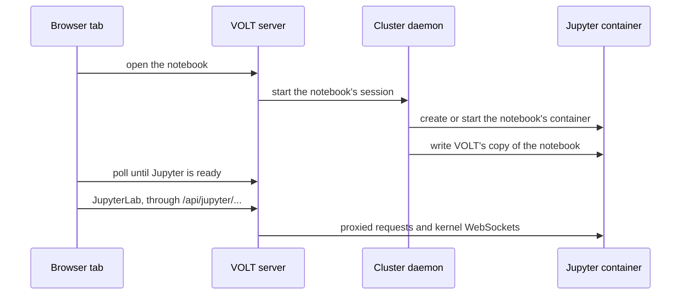

A notebook is a Jupyter notebook that VOLT stores for your team. Its kernel has the Python SDK, `voltsdk`, installed and already signed in to your team, so a cell can list trajectories, load analysis results as DataFrames, read per-atom data and plot it without any setup. Use notebooks for exploratory work and one-off processing; for a workflow the whole team runs again and again, write a plugin instead.

Where the kernel runs depends on how you run VOLT:

| | On a server (self-hosted or cloud) | In the browser or the desktop app |
|---|---|---|
| Opening a notebook | JupyterLab, in a new browser tab | The notebook editor, at `/dashboard/notebooks/:notebookId` |
| The kernel | A Jupyter container on one of the team's clusters | A Python process (CPython compiled to WebAssembly) in the page |
| Needs | A connected cluster with a container runtime (Docker) | Nothing else |
| Packages | The Jupyter image's scientific stack (see [The Jupyter image](#the-jupyter-image)) | `voltsdk`, plus what you install with `%pip` |

## The Notebooks page

Open **Notebooks** in the sidebar (`/dashboard/notebooks`). The list shows the team's general notebooks with the columns **Title**, **Cluster**, **Created By** and **Last Opened At**.

Click a row to open the notebook. Each row's menu has:

| Action | What it does |
|---|---|
| **Open in new Tab** (on a server) / **Open** (browser or desktop) | Opens the notebook, as a click on the row does. |
| **Rename** | Changes the title (up to 120 characters). |
| **Delete** | Deletes the notebook after you confirm. This also removes its Jupyter container and revokes its secret key. It cannot be undone. |

On a server, if the selected cluster reports no container runtime, the page shows **Notebooks needs a container runtime** instead of the list. Install Docker on that machine; the page works again after the cluster's next heartbeat.

### Create a notebook

Click **New Notebook** (or **Create notebook** when the list is empty).

- **On a server**, the **Create Notebook** dialog asks for the **Cluster** whose machine will run the notebook's Jupyter container, then **Create notebook** saves it. The cluster must be connected. If the team has a single cluster, it is selected for you and the dialog has nothing to choose. The new notebook appears in the list; open it from there.
- **In the browser or the desktop app**, the notebook is created right away and opens in the editor. Its kernel runs in the page, so there is no cluster to choose.

A new notebook is titled **Untitled Notebook** and starts from a template that walks through the SDK: connecting, loading a trajectory, listing its analyses, turning an analysis into a DataFrame, reading a frame's atoms, plotting, downloading artifacts and opening a trajectory in the canvas. On a server, the template also includes an OVITO example (CNA, atomic strain, structure fractions over time). The in-page kernel cannot install OVITO, so notebooks created in the browser or the desktop app leave it out.

## General and trajectory notebooks

A **general** notebook belongs to the team and to no trajectory in particular. These are the notebooks the Notebooks page lists and creates.

A **trajectory** notebook is linked to one trajectory. Its kernel gets that trajectory's id in `VOLT_TRAJECTORY_ID`, and the template's cells load that trajectory instead of listing all of them. A trajectory has one such notebook, which is reused each time. Trajectory notebooks are created through the API, by starting a Jupyter session for a trajectory (see [REST & realtime API](/docs/develop/rest-api)); the Notebooks page does not list them. Deleting a trajectory deletes its notebooks, with their containers and secret keys.

## Notebooks in JupyterLab (on a server)

When you open a notebook on a server, VOLT opens a new tab that shows **Opening notebook...** while it starts the notebook's Jupyter container, then loads JupyterLab in that tab. If the container is not ready after two minutes, the tab shows **Notebook is still starting**; open the notebook again in a moment.

A notebook without a cluster asks for one first: the **Configure Notebook Deployment** dialog saves the cluster and opens the notebook with **Save and open**. The notebook's cluster must be connected for the notebook to open.



How the container behaves:

- **One container per notebook.** It runs JupyterLab from the cluster's Jupyter image and may use all of the machine's CPUs and memory.
- **Served through VOLT.** VOLT opens JupyterLab through its server. Each request checks that you are a member of the team with the `scripting:read` permission. The link VOLT opens carries an access token, valid for 7 days by default.
- **Reused.** Opening the notebook again reuses its container, and starts it if it was stopped. VOLT creates a new container, which keeps the notebook but none of the old one's other files, when the cluster's Jupyter image or settings change or when a different member opens the notebook.
- **Removed** when you delete the notebook, when the notebook moves to another cluster, when its trajectory is deleted, or when its session is stopped through the API or VOLT AI. There is no idle timeout.

<Callout type="warn">
What you save in JupyterLab is kept in the notebook's container. Each time you open the notebook from VOLT, VOLT reads that file and stores it as its own copy, and a container that VOLT recreates starts from it. Edits saved after the last time you opened the notebook stay only in the container, so they are lost if the container is removed before the next open: when you delete the notebook, move it to another cluster, or stop its session. Keep results by writing them through `voltsdk` or downloading them.
</Callout>

### The Jupyter image

Clusters run notebooks from `ghcr.io/voltlabs-research/volt-jupyter-scripting:main`, published for `linux/amd64` from the VOLT repository. A cluster's daemon uses another image when its `JUPYTER_IMAGE` variable names one.

The image is built on Jupyter Docker Stacks' `scipy-notebook`, so NumPy, SciPy, pandas, matplotlib and the rest of that scientific stack are there. On top of it, the image installs:

| Package | Version |
|---|---|
| `jupyterlab` | 4.5.8 |
| `voltsdk` | 3.1.1 |
| `ovito` | 3.15.4 |
| `ase` | 3.28.0 |
| `pymatgen` | 2026.5.4 |
| `MDAnalysis` | 2.10.0 |
| `matminer` | 0.10.1 |
| `vtk` | 9.6.2 |
| `pyarrow` | 24.0.0 |
| `pandas` | 2.3.3 |

## Notebooks in the app (browser and desktop)

When VOLT runs in your browser tab or in the desktop app, a notebook opens in VOLT's own editor and its kernel runs in the page. The editor is a sequence of cells: code cells (Python) and text cells (Markdown).

### The editor

The header holds the notebook's title, its save state and its kernel's state, and these buttons:

| Button | What it does |
|---|---|
| **Back to notebooks** | Returns to the Notebooks page. |
| **Run all cells** | Runs every code cell in order. |
| **Interrupt** | Stops the running cell (`KeyboardInterrupt`) and cancels an `input()` it waits on. |
| **Restart the kernel** | Starts a new kernel. Variables are lost; the workspace's packages and files stay. |

Below the last cell, **Code** and **Text** add a cell. Hover a cell to show its toolbar: **Make a text cell** (or **Make a code cell**), **Move up**, **Move down** and **Delete cell**. The **Run cell** button and the execution count, `[n]`, sit to the left of each code cell.

| Keys | In a code cell |
|---|---|
| `Ctrl+Enter` / `Cmd+Enter` | Run the cell. |
| `Shift+Enter` | Run the cell and move to the next one, adding a code cell at the end. |
| `Alt+Enter` | Run the cell and insert a code cell below it. |
| `Ctrl+Space`, or typing `.` | Completions from the kernel. |

A text cell shows its rendered Markdown. Double-click it, or press `Enter` on it, to edit; run it (for example with `Shift+Enter`) to render it again.

Outputs appear under their cell: text streams (standard error highlighted), errors with their traceback, images (PNG, JPEG, SVG), Markdown, JSON, and HTML such as a DataFrame's table. HTML output runs in an isolated frame, apart from the app. When a cell calls `input()` or `getpass()`, a field with **Send** appears under it.

The notebook saves itself: one second after you stop typing, and at least every ten seconds while a cell keeps printing. Leaving the editor saves what is not saved yet. The header shows **Saved**, **Unsaved changes**, **Saving…** or **Not saved**. Outputs, images included, are saved with the notebook.

The kernel's state is shown as a pill:

| Pill | Meaning |
|---|---|
| **connecting** | The editor is getting the kernel's credentials from the server. |
| **starting** | The Python process is starting. Kernels start one at a time. |
| **preparing** | The workspace's Python environment is being set up (see below). |
| **ready** | The kernel is idle and runs cells. |
| **running** | A cell is running. |
| **failed** | The kernel stopped; the banner says why and offers **Restart**. |
| **no kernel** | This window does not run kernels (the editor was opened on a server). |

A notebook's kernel stays up while the app is open, so you can leave a notebook and come back to its variables. Closing the tab or the app ends the kernels.

### The workspace environment

All the notebooks of a team share one Python virtual environment and one working directory, kept in the browser's or the app's private storage. What one notebook installs or writes, the others have.

The first kernel of a team creates the environment and installs `voltsdk`. The editor shows **Preparing this workspace's Python environment. The first time, its packages are downloaded; then notebooks start in seconds.** The SDK installed is the build that ships with your VOLT, not PyPI's, and kernels replace it when VOLT is updated.

Install more packages from a cell with `%pip install <package>`. Packages with native code come from Pyodide's builds (NumPy, pandas, pyarrow, scikit-learn and others); pure-Python packages come from PyPI. The first install of a package downloads it, so it needs the network; later kernels reuse it.

Python runs as a guest of the page, which limits a few things:

- There are no subprocesses and no threads. Shell commands (`!command`) raise an error; use `%pip` to install packages.
- `%pip` is the only IPython magic. `%matplotlib`, `%config`, `%load_ext`, `%reload_ext` and `%autoreload` are ignored; others raise an error.
- OVITO cannot be installed, and the SDK's `SpatialAssembler` is not available.

See [Run in the browser](/docs/run/browser) and [Desktop app](/docs/run/desktop) for how the in-page stack works.

## How voltsdk is signed in

`VoltClient.from_env()` reads its credentials from the kernel's environment, in JupyterLab and in the in-page kernel alike:

```python
from voltsdk import VoltClient

client = VoltClient.from_env()
print(client.team.get('name'))
```

| Variable | Value |
|---|---|
| `VOLT_BASE_URL` | The VOLT server's API URL (`<server>/api`). |
| `VOLT_SECRET_KEY` | The notebook's secret key. |
| `VOLT_TEAM_ID` | The team's id. |
| `VOLT_NOTEBOOK_ID` | The notebook's id. |
| `VOLT_NOTEBOOK_PATH` | The notebook's file name. |
| `VOLT_REQUESTED_BY` | The id of the member who started the kernel or the container. |
| `VOLT_TRAJECTORY_ID` | The linked trajectory's id. Trajectory notebooks only. |
| `VOLT_PUBLIC_BASE_PATH` | The path VOLT serves JupyterLab under. JupyterLab only. |

The first time a notebook opens, VOLT creates a secret key for it, named `notebook:<notebook id>`, with the role of the member who opened it. Every later session of that notebook uses the same key, whoever opens it, so the code in a notebook acts with that first member's permissions. The key is listed with the team's other keys on [Secret keys](/docs/guides/secret-keys) and is revoked when the notebook is deleted.

For everything the SDK does, see [Python SDK](/docs/develop/python-sdk).

## Permissions

The Notebooks page and the editor need the `plugin:read` permission. The server checks each notebook operation against the `scripting` permissions, and the page's menu also checks plugin permissions before it offers **Rename** and **Delete**:

| Operation | Server permission | Also required by the page |
|---|---|---|
| List notebooks, open one in the editor, use JupyterLab | `scripting:read` | `plugin:read` |
| Create a notebook, start its Jupyter session or its in-page kernel | `scripting:create` | `plugin:read` |
| Rename, change its cluster, save its content | `scripting:update` | `plugin:update` (to rename) |
| Delete a notebook, stop its Jupyter session | `scripting:delete` | `plugin:delete` |

Opening a notebook starts a session or a kernel, so it needs `scripting:create`. Of the system roles, Owner and Admin have all of these; Member has every `scripting` permission but neither `plugin:update` nor `plugin:delete`, so the page does not offer it **Rename** or **Delete**; Viewer can list notebooks but cannot start a Jupyter session or a kernel. See [Teams](/docs/guides/teams) for roles.

VOLT AI can also create, list, update and delete notebooks and start and stop their Jupyter sessions; see [VOLT AI](/docs/guides/volt-ai).
