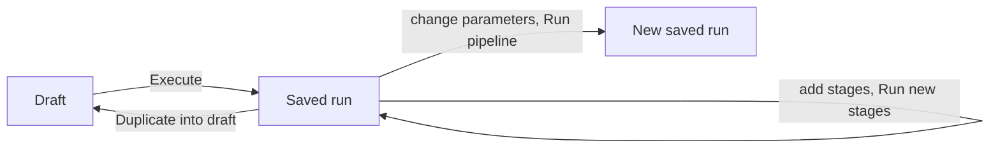

A pipeline is an ordered list of stages applied to a trajectory, frame by frame. Some stages change the
atoms (cut them with a plane, delete a selection), others run a plugin that computes something. Each stage
reads what the stages before it left, so an analysis placed after a slice plane only sees the atoms that
survived the cut.

You build pipelines in the [canvas](/docs/guides/canvas#pipeline-panel). Running one sends its stages to a
cluster, which works through the selected frames and stores every analysis's results. The run is saved, so
you can come back to it, extend it with more stages, or run it again with other parameters.

## Stage types

**Add modification…** in the pipeline panel lists **Slice Plane**, **Expression Select** and **Color Coding**,
then every plugin installed in the team. Plugins can also be added with the [plugin search](/docs/guides/canvas#plugin-search).

| Stage | Sent to the cluster | What it does |
| --- | --- | --- |
| Analysis (a plugin) | Yes | Runs the plugin on each selected frame and stores its results |
| **Slice Plane** | Yes | Removes the atoms on one side of a plane before the stages after it. The viewport shows the cut as soon as you edit it. |
| **Expression Select** with **Delete** | Yes | Removes the atoms that match an expression before the stages after it. The viewport hides them as soon as you apply it. |
| **Expression Select** with **Color** | No | Highlights the matching atoms in the viewport |
| **Color Coding** | No | Bakes a model of the current frame colored by a property, and shows it |

The stages that stay in the browser change what you see, not what is computed.

### Analysis

Selecting an analysis stage shows the plugin's parameters as fields. A parameter that takes a frame lists the
trajectory's timesteps as `t=<timestep>`. Changes are kept as you make them; there is nothing to save. What
each plugin computes and its parameters are described in the [plugin catalog](/docs/plugins).

### Slice Plane

| Field | Meaning |
| --- | --- |
| **Distance** | Distance of the plane from the origin along the normal, in Cartesian coordinates |
| **Normal X**, **Normal Y**, **Normal Z** | The plane's normal. Defaults to (1, 0, 0). |
| **Reverse Orientation** | Flips which side of the plane is removed |
| **Visualize Plane** | Draws the plane in the viewport |

When the pipeline runs, the cluster keeps the atoms behind the plane, those with **n · r** ≤ **Distance** for the
normalized normal **n**, and
removes the others. **Reverse Orientation** keeps the other side.

### Expression Select

Type a condition in the expression field. Refer to per-atom properties by the names the
[per-atom viewer](/docs/guides/trajectories#per-atom-viewer) shows, such as `x`, `y`, `z`, `type` and the columns
of the frame or the current analysis:

```text
x > 10 && type == 2
```

The language has `+ - * / ^`, the comparisons `== != < > <= >=`, `&&`, `||` and `!`, parentheses, and the
variables `ParticleIndex` (the atom's position in the frame) and `N` (the number of atoms).

Below the field, the editor counts the matching atoms among the first 1,000 of the current frame
(`212 of first 1,000 atoms`), or of the whole frame when it is smaller. An invalid expression shows its error
there instead.

The viewport applies the expression to frames of up to 1,000,000 atoms. Larger frames are not previewed in the
browser, but a **Delete** stage still runs on the cluster.

**With selection** chooses what to do with the matches:

- **Color** paints them in the **Highlight** color. This happens only in your viewport.
- **Delete** removes them. The apply button becomes **Delete N atoms** when the whole frame was counted. The
  stage is sent to the cluster when the pipeline runs, so later stages don't see the deleted atoms.

Press **Apply** to use the expression, or **Revert** to go back to the applied one.

### Color Coding

| Field | Meaning |
| --- | --- |
| **Property** | A per-atom property of the frame or of the current analysis |
| **Color Gradient** | Viridis, Plasma, Magma, Inferno, Cividis, RdBu, Coolwarm, Jet or Grayscale |
| **Start value**, **End value** | The range mapped onto the gradient. Leave them blank to use the property's minimum and maximum at the current frame, computed on the cluster. |

A text property, such as a structure name, is colored with a discrete palette instead of a gradient.

**Apply (bake)** builds the colored model of the current frame on the cluster and shows it. The model is kept:
it appears under **Color Coding** at the foot of the pipeline panel and on the
[Artifacts](/docs/guides/trajectories#artifacts) page. Color coding is never part of a run.

## The draft

**Draft**, the first entry under **Pipelines**, is the pipeline you are building. It is kept per trajectory in
your browser, so it survives a reload but your teammates don't see it.

- New stages go to the top of **Modifications**: the list reads from the newest stage down to the oldest.
- Drag stages to reorder them, or use **Move modification up** and **Move modification down**.
- Untick a stage to disable it without removing it. Disabled stages are not sent and don't affect the
  viewport. Slice planes and analysis stages can be disabled only after they have run once.
- **Delete modification** removes the selected stage. **Clear draft**, from the draft's right-click menu,
  removes them all.

## Running a pipeline

Press the run button (**▶**, **Run pipeline**) next to **Add modification…**. A popover titled **Pipeline** shows:

- What will run: `Runs the 3 enabled stages as one pipeline.`
- **Cluster**, when the team has more than one compute cluster. With one, the pipeline runs there. With none,
  the popover reads **No compute cluster is connected to this team. Set one up to run the pipeline.**
- **Selected Timesteps**, the frames to run on. It starts with the frame on screen. Clear it (**All**) to run on
  every frame, or pick several.

Press **Execute**. VOLT sends the enabled slice planes, expression selections set to **Delete** and analyses,
in order, and:

- Creates an analysis for every analysis stage that has to be computed, and saves the run.
- Shows **Pipeline is running** with the number of analysis stages computing, or **Pipeline complete** with
  **All stages were served from cache.** when nothing had to be computed.
- When something is computed, selects the run's first analysis, moves to the first selected frame unless the
  frame on screen is one of them, and opens the **Log** tab of the timeline, which follows the run. The panel
  switches to the new run as soon as it appears under **Pipelines**.

The draft keeps its stages, so you can change one and run again.

On the cluster, each selected frame becomes one job that runs every stage in order on that frame. In the jobs
list you see one job per frame for each analysis, named after its plugin. See [Jobs](/docs/guides/jobs).

### Stages that need an earlier stage

Some plugins read results of another plugin. If such a plugin comes without the stage it needs before it, the
run is refused with `<Plugin> needs an earlier stage` and the names of what to add before it.

## Saved runs

Every execution creates a saved run with its stages, their parameters, the selected timesteps and the cluster.
Runs are stored on the server, so every member of the team sees them under **Pipelines**, newest first.

A run is named after its analyses (`Polyhedral Template Matching → Coordination Analysis`, with `+N` past three)
until you rename it. Its state is the combined state of its analyses:

| State | When |
| --- | --- |
| **Running** | At least one analysis is running |
| **Queued** | None is running and at least one is waiting |
| No label (time since it ran) | Every analysis completed |
| **Failed** | Anything else: at least one analysis failed |

Right-click a run for:

- **Duplicate into draft**: replaces the draft's stages with this run's, with the same parameters. The toast
  reads **Pipeline restored**. Run it to compute it again, for example on other frames.
- **Rename**: names the run, up to 120 characters. Clear the name to go back to the automatic one.
- **Delete**: deletes the run and the analyses it computed, with their results, right away and without a
  confirmation. Results it reused from other runs stay.

Analyses created outside any pipeline, for example through the API, are listed under **Ungrouped**. They show
their results like any run, but take no new stages.

## Extending a saved run

You can add stages to a saved run instead of building a new pipeline. The run keeps its stages and its
results, and the new stages are appended after them.

<Steps>
<Step>
Select the run under **Pipelines** and wait until it has finished.
</Step>
<Step>
Add stages with **Add modification…** or the plugin search. They are listed above the run's own stages and
stay in your browser until you run them.
</Step>
<Step>
Press the run button, labeled **Run new stages** now. The popover reads `Runs the 1 new stage. The others reuse their
saved results.` There is no cluster or timestep choice: the new stages run on the run's own frames and cluster.
</Step>
<Step>
Press **Execute**. The saved stages are served from cache, only the new ones are computed, and they become part
of the same run.
</Step>
</Steps>

A run that is still computing can't take new stages: the popover reads **Wait for this pipeline to finish
before running new stages on it.** If a stage of the run can no longer be served from cache, because its plugin
was updated or its results were deleted, the server refuses with **This pipeline changed since it ran (a plugin
was updated or a result was removed). Duplicate it into the draft and run it again.**

## Changing a saved run's parameters

Select an analysis of a saved run to see its parameters as fields you can change. A changed analysis shows
**edited** in **Modifications**. Changes stay in your browser, apart from the run, until you run them.

Press the run button, labeled **Run pipeline**. The popover reads `Runs as a new pipeline with the changed stage.
This one stays as it ran, and unchanged stages reuse their results.` **Execute** creates a new run with every
stage of the old one, your changes, and any stages you added, on the old run's frames and cluster. The old run
is not modified.



## Caching

Before computing an analysis stage, the server looks for a completed analysis of the same trajectory with:

- the same plugin, in the same build,
- the same parameters,
- the same selected timesteps,
- and the same stages before it: the same slice planes and deletions, and the same earlier analyses.

If it finds one, the stage reuses its results instead of running, and its row shows **cached**. In practice:

- Running the same pipeline again computes nothing.
- Changing a stage recomputes that stage and every analysis after it; the stages before it are reused.
- Changing the selected timesteps recomputes everything.
- Updating a plugin, or deleting an analysis, means its results can't be reused.

## Analysis statuses

| Status | Meaning |
| --- | --- |
| `pending` | Created, waiting for its frames to start |
| `running` | Frames are being computed |
| `completed` | Every frame completed |
| `failed` | At least one frame failed. The other frames' results are still there. |

## The analysis listing

`/dashboard/analysis-configs/list`, **Analysis** → **View all** in the sidebar, lists every analysis of the team,
titled **Analysis Configs**. It updates live as analyses are created and change state.

| Column | Content |
| --- | --- |
| **Trajectory** | The trajectory it ran on. Click it for the trajectory's details. |
| **Plugin** | The plugin's name |
| **Status** | `pending`, `running`, `completed` or `failed` |
| **Created By** | Who ran it |
| **Finished At** | When it finished |
| **Results** | **View results**, once it has completed and has a results listing. See [Analysis results](/docs/guides/results). |

Click a row to open the trajectory in the canvas with that analysis selected. Right-click a row for:

| Action | What it does |
| --- | --- |
| **View Scene** | Same as clicking the row |
| **Retry Failed Frames** | Queues the analysis's failed frames again |
| **Delete** | Deletes the analysis and its results, after a confirmation. Applies to every selected row. |
| **Copy Document ID** | Copies the analysis's ID |

With no analyses yet, the page reads **No analyses yet** with **Open trajectories**.

## Retrying failed frames

When some frames of an analysis fail, you don't have to run the pipeline again:

- **Retry Failed Frames** on the analysis listing queues every failed frame of that analysis.
- In the jobs list, a failed analysis job has a **Retry** button, and **Retry Failed Jobs** on a trajectory's
  group retries all its failed jobs. See [Jobs](/docs/guides/jobs).

The toast reports what was queued (`Queued 2 failed frames for retry`) or **No failed frames found to retry**.
Retrying works from the jobs VOLT still lists, so it finds frames that failed in the last 24 hours.
