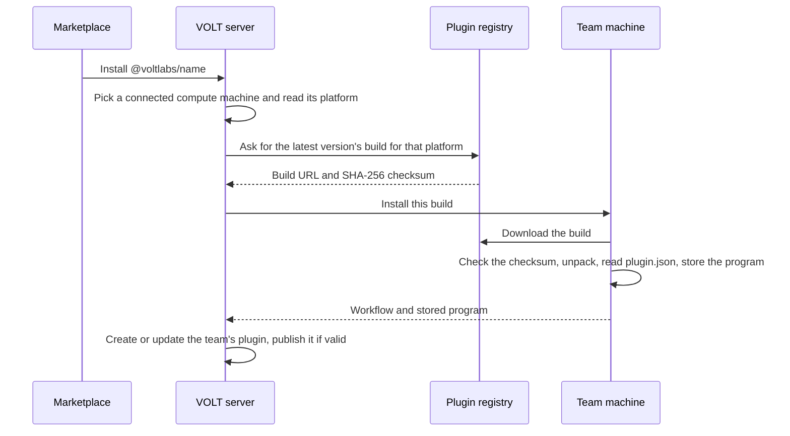

A plugin is an analysis your team can run on its trajectories: structure identification, dislocation extraction, strain, clustering and so on. Each plugin bundles a program with a workflow that tells VOLT which arguments to ask you for, how to run the program on each frame, and how to present what it writes: listings, per-atom properties, charts and 3D models in the canvas. Plugins belong to a team, and they run on the team's machines (see [Clusters](/docs/guides/clusters)).

You get plugins in three ways: install them from the public registry through the **Marketplace**, import a `.zip` someone exported, or build one in the **Plugin Builder**. The [plugin catalog](/docs/plugins) describes every plugin published in the registry.

## Where plugins live

The **Plugins** section of the sidebar has two pages:

| Page | Path | What it is for |
|---|---|---|
| **Installed** | `/dashboard/plugins/list` | Your team's plugins, their status and their actions. |
| **Marketplace** | `/dashboard/plugins/marketplace` | Search the registry and install or update plugins. |

The Plugin Builder opens at `/plugins/builder`. The results of plugins are under **Analysis** in the sidebar: one entry per plugin, with one page per listing it produces (see [Analysis results](/docs/guides/results)).

What you can do depends on your role's permissions on plugins (see [Teams](/docs/guides/teams)):

| Permission | Lets you |
|---|---|
| `plugin:read` | See the Installed list, the Marketplace and plugin results; export a plugin. |
| `plugin:create` | Install from the Marketplace, create, clone and import plugins, open the Plugin Builder. |
| `plugin:update` | Edit a plugin, publish it, set it as draft or disable it. |
| `plugin:delete` | Delete a plugin. |

## Install a plugin from the Marketplace

<Screenshot name="marketplace" alt="The Marketplace: the registry's plugins listed at the left and the selected plugin's details with its Install button" />

<Steps>
<Step>
Open **Plugins** › **Marketplace**. The list shows up to 30 of the registry's plugins, each with its publisher and latest version. Type in **Search plugins…** to search the registry.
</Step>
<Step>
Select a plugin. The detail panel shows its description and **Latest version**, **Installed version** (if your team has it), **Author**, **Package** (for example `@voltlabs/opendxa`), **Kind**, **Downloads**, **Last 30 days** and **Updated**.
</Step>
<Step>
Click **Install**. A toast shows **Installing plugin onto a cluster...** and then **Plugin installed**. The plugin appears in the Installed list.
</Step>
</Steps>

The list marks the plugins your team already has: **Installed** when you have the latest version, **Update** when the registry has a newer one. In the detail panel the button reads **Update** for a newer version, and the panel shows **Installed** instead of a button when you're up to date. Only one install runs at a time.

The Marketplace always installs the latest version. [VOLT AI](/docs/guides/volt-ai) can also search the registry and install plugins, and its install tool accepts a specific version.

### Updating

**Update** installs the latest version over the plugin your team has with the same key. The plugin keeps its id, so its results and the pipelines that use it stay attached to it. Its workflow and program are replaced, and its status is set again as for a new install.

## How a plugin gets onto a machine

A plugin is published to the registry once per platform. When you install it, VOLT fetches the build that matches the machine that will receive it:

1. **A machine.** VOLT picks one of your team's connected machines that accepts compute work. Without one, the install fails with `A connected compute-capable team cluster is required for this operation`.
2. **Its platform.** Each machine reports the platform it runs plugins for. VOLT waits up to 30 seconds for a machine that hasn't reported yet, then fails with `The compute daemon has not reported its host platform yet. Wait until the cluster is connected and try again.`
3. **The build.** The server asks the registry for that platform's build of the latest version:

   | Platform | Machine |
   |---|---|
   | `linux-x86_64` | A cluster daemon on 64-bit x86 Linux |
   | `darwin-arm64` | A cluster daemon on an Apple silicon Mac |
   | `windows-x86_64` | A cluster daemon on 64-bit x86 Windows |
   | `wasm-wasm32` | The stack running in a browser tab or in the desktop app ([Run in the browser](/docs/run/browser), [Desktop app](/docs/run/desktop)) |

   Not every plugin has every build: the [catalog](/docs/plugins) lists them. If the registry has no build for the machine's platform, the install fails.
4. **Download and store.** The machine downloads the build, checks it against the registry's SHA-256 checksum, unpacks it, reads its `plugin.json` and stores the program in its object storage.
5. **The plugin.** VOLT creates the plugin in your team, or updates the one with the same key, as **Draft**, and publishes it right away if its workflow is valid. A plugin that fails validation stays a draft; open it in the Plugin Builder to see why.

The team keeps one build per plugin: the build for the machine VOLT picked. Every machine that runs the plugin uses that build.

### Running and warm-up

A machine prepares a plugin the first time it runs it. It downloads the program from the machine that stores it and keeps a local copy. For a plugin that runs a Python script (MultiSOM and K-means Clustering, for example), it also creates a virtual environment and installs the script's requirements, so the first run takes longer than the next ones.

When you publish a Python plugin from the Installed list, VOLT also asks each of the team's machines to prepare it ahead of time, a warm-up, so the first run doesn't wait for the installs. Installs from the Marketplace don't trigger a warm-up; the first run prepares the plugin.

## The Installed list

**Plugins** › **Installed** lists your team's plugins with their **Name**, **Version**, **Status**, the number of **Exposures** (the results the workflow defines) and **Created** date. Click a row to open the plugin in the Plugin Builder.

| Status | Meaning |
|---|---|
| **Draft** | Saved but not usable in pipelines. New, cloned and imported plugins start here. |
| **Published** | Valid and available as a stage in the canvas. |
| **Disabled** | Kept in the team, but not offered in the canvas and not runnable. |

Each row's menu has these actions:

| Action | What it does |
|---|---|
| **Edit** | Opens the plugin in the Plugin Builder. |
| **Clone** | Creates a draft copy named "*name* (Copy)" and opens it in the builder. |
| **Export** | Downloads the plugin as a `.zip` with its `plugin.json` and its program. |
| **Publish** | Validates the workflow and publishes it. An invalid workflow is refused with `Plugin not valid, cannot publish:` and the list of problems. |
| **Set as Draft** | Takes a published plugin out of the canvas. |
| **Disable** | Disables the plugin. |
| **Delete** | Deletes the plugin after you confirm. This can't be undone. |

The status actions show only the statuses the plugin isn't in. With several rows selected, **Delete** deletes all of them; the status actions work on one plugin at a time.

**New plugin** opens an empty Plugin Builder. **Import** takes a `.zip` exported from VOLT, creates a plugin from it, and publishes it if its workflow is valid.

### Uninstalling

To uninstall a plugin, **Delete** it from the Installed list. It disappears from the canvas and the sidebar, and its 3D results are removed from the canvas. You can install it again from the Marketplace at any time.

## Use a plugin in a pipeline

Published plugins are stages of a trajectory's pipeline in the [canvas](/docs/guides/canvas):

1. In the pipeline panel, open **Add modification…** and choose the plugin by its name, for example **Polyhedral Template Matching**.
2. Set its arguments in the stage's form. A **frame** argument, such as a reference frame, lists the trajectory's timesteps as `t=<timestep>`.
3. Add more stages if you need them, then run the pipeline.

The stage runs the plugin once per selected frame. [Pipelines and analyses](/docs/guides/pipelines) covers runs, frames and caching, and [Analysis results](/docs/guides/results) the listings, charts and 3D models the plugin produces.

Some arguments never appear in the form: they are filled in from what earlier stages of the same pipeline shared. OpenDXA, for example, reads the crystal clusters of a Polyhedral Template Matching stage, so PTM has to come first. [How plugins feed each other](/docs/plugins#how-plugins-feed-each-other) lists these links.

## The Plugin Builder

The Plugin Builder (`/plugins/builder`) is a node editor for a plugin's workflow. You open it with **New plugin**, **Edit** or a click on a row. Writing a plugin is covered in [Writing plugins](/docs/develop/plugins); this is what the builder offers:

<Screenshot name="plugin-builder" alt="The Plugin Builder showing Coordination Analysis as a workflow of nodes, with the node palette at the left and the debug toolbar on top" />

- **Palette.** The sidebar lists the node types: **Modifier** (plugin metadata and configuration), **Arguments**, **Context**, **ForEach**, **Entrypoint**, **Plugin Node** (run another published plugin inline), **Exposure**, **Export**, **If Statement**, **Switch Statement** and **Switch Case**. Drag one onto the canvas, or click it to add it. An empty plugin offers **Add Modifier Node** and the usual chain Modifier › Arguments › Context › ForEach › Entrypoint › Exposure.
- **Editing.** Click a node to edit it in its panel. Connect outputs to inputs to build the workflow. Double-click the plugin's name at the top of the sidebar to rename it.
- **Saving.** **Save** (Ctrl+S) in the bottom toolbar saves the workflow; the first save creates the plugin as a draft. The toolbar also shows the save status and zoom controls. Leaving with unsaved changes asks you to confirm.
- **Validation.** Problems that would block publishing appear as "*n* issues to fix before publishing" above the toolbar, each with its message.
- **Debugging.** The debug toolbar runs the workflow on one frame of a real trajectory. Pick a **Trajectory** and a **Frame**, then start the run; if the plugin has arguments, VOLT asks for them first. The run pauses at each node: **Step to next node**, **Continue (run all remaining)** or **Stop debug session**. The node being run and each node's output show on the canvas.
- **Shortcuts.** Ctrl+S saves, Delete removes the selected node, Ctrl+Z undoes and Ctrl+Shift+Z redoes.

A plugin you build is used like any other: publish it from the Installed list, then add it in the canvas.
