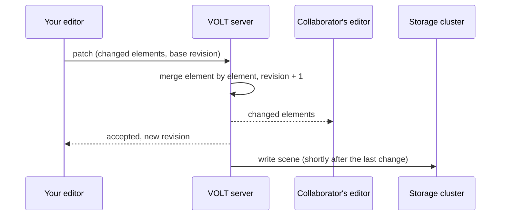

A whiteboard is a shared drawing canvas that belongs to a team. Use it to sketch a pipeline, annotate a
defect structure, or plan a simulation campaign next to the trajectories it explains. Everyone in the
team who opens the same board sees the others' changes as they make them.

The editor is [Excalidraw](https://excalidraw.com): shapes, arrows, lines, freehand drawing, text and
images, with VOLT handling storage, image uploads and live sync.

## The listing

Open **Whiteboards** in the sidebar (`/dashboard/whiteboards`). The table lists the boards and folders at
the current location with the columns **Title**, **Last Edited By** and **Updated At**. Whiteboards are
sorted with the most recently updated first.

- **New Whiteboard** creates a board named **Untitled Whiteboard** in the current folder and opens it.
- Click a row to open a whiteboard or enter a folder. The breadcrumb in the header takes you back up.
- A row's menu has **Open Whiteboard**, **Rename**, **Move to Folder** and **Delete**. Deleting asks for
  confirmation and cannot be undone. **Rename** opens **Rename Whiteboard**, which accepts titles of up to
  120 characters.

### Folders

Folders nest: you can create folders inside folders.

- **New Folder** in the header creates a folder in the current location.
- Inside a folder, the header menu has **Rename Folder** and **Delete Folder**. Folder rows have
  **Open Folder**, **Rename Folder** and **Delete Folder** in their menu.
- Move a whiteboard with **Move to Folder**, or drag its row onto a folder. Dragging is available when your
  role can update whiteboards.

<Callout type="warn">
Deleting a folder deletes everything in it, recursively: its subfolders and every whiteboard inside them,
with their drawings and images.
</Callout>

## The editor

A whiteboard opens at `/dashboard/whiteboard/:whiteboardId`, taking the whole page.

- If you change the board's name inside Excalidraw, VOLT renames the whiteboard about a second after you
  stop typing.
- The main menu has **Back to Whiteboards**, **Insert image**, and Excalidraw's own items to export the
  board as an image, clear the canvas, switch the theme and change the canvas background.
- The top-right corner shows how many people have the board open (for example **2 collaborators online**),
  the **Insert image** button, and the VOLT AI assistant. The count is hidden in a local deployment.

The canvas background color and grid settings are part of the board and are shared with everyone. Your zoom,
scroll position, selection and current tool are yours alone.

### Images

Add images in any of three ways:

- **Insert image** (top-right button or main menu) opens a file picker. You can pick several files.
- Drag image files from your computer onto the canvas. They land where you drop them.
- Paste an image from the clipboard.

Any file with an `image/*` type is accepted. Each image is uploaded to the team's storage before it appears
on the board, so collaborators load it from VOLT rather than from your browser. An image is scaled down to
fit within about two thirds of the visible canvas, and several images inserted at once are stacked with a
small offset.

When you paste elements copied from another whiteboard, their images are uploaded again into this board, so
the copy does not depend on the original.

### Drawing with VOLT AI

The VOLT AI assistant in the editor can create whiteboards and draw on them: rectangles, ellipses,
diamonds, text, arrows and lines, with arrows bound to the shapes they connect. When it draws, it opens the
board and adds the elements to the canvas, where they sync like any other edit. See
[VOLT AI](/docs/guides/volt-ai).

## Live collaboration

When you open a whiteboard, the editor joins the board's live session on the server and receives the
current scene. From then on:

1. Your edits are batched for a fraction of a second and sent as a patch that contains only the elements
   that changed.
2. The server merges the patch into the board and forwards the changed elements to everyone else on the
   board.
3. Incoming changes are merged into your canvas without replacing what you are drawing.

Presence is a count of who has the board open. When someone joins or leaves, the editor announces it to
screen readers ("… joined the whiteboard."). Collaborators' cursors and selections are not shown.

### Conflicts

The server merges element by element, so two people editing different shapes never conflict. When two
people change the same shape, the server keeps the copy with the higher version (Excalidraw raises an
element's version on every edit). Equal versions are decided by the later edit time.

If your patch was based on an older revision than the server's, the server still merges it, then sends you
the whole current scene. Your editor applies it, re-sends any of your changes that did not make it in, and
shows **Canvas synced — someone else was editing at the same time.** (at most once every five seconds).

If the connection drops, your pending changes are kept and sent after the editor reconnects and receives the
current scene.

## Persistence

Each whiteboard is stored on the team's storage cluster: the scene as a JSON document, and its images next to
it. Creating a whiteboard therefore needs a connected cluster that accepts storage; see
[Clusters](/docs/guides/clusters).

While a board is open, the server holds its scene in memory and writes it to storage half a second after the
last change, and once more when the last person leaves. There is no save button. **Last Edited By** in the
listing is the last person who changed the board or renamed it.

Deleting a whiteboard removes its scene and all of its images. Deleting a team deletes all of its whiteboards.

## Permissions

Whiteboards use the `whiteboard` resource of the team's roles (see [Teams](/docs/guides/teams)):

| Action | Needs |
| --- | --- |
| See the listing, open a board | `whiteboard:read` |
| Create a whiteboard or folder, upload an image | `whiteboard:create` |
| Rename or move a whiteboard, rename a folder | `whiteboard:update` |
| Delete a whiteboard or folder | `whiteboard:delete` |

The **Owner**, **Admin** and **Member** system roles have all four. **Viewer** has `whiteboard:read` only.

Edits made inside an open editor travel over the live session, which checks that you are a member of the
board's team. It does not check the role's `whiteboard:update`.

Creating and deleting whiteboards is recorded in the team's activity, shown on **My Team**.
