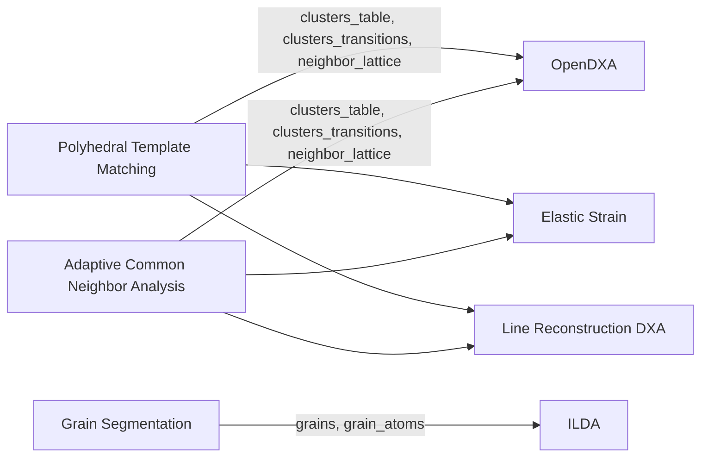

These are the analysis plugins published in the public registry at `registry.voltcloud.dev` under `@voltlabs`. Install them from the **Marketplace** in the app (see [Plugins in the app](/docs/guides/plugins)), then add them as stages to a trajectory's pipeline in the [canvas](/docs/guides/pipelines).

Each plugin page lists what the plugin computes, what it needs from earlier stages, every argument with its default, and the results it produces.

## Catalog

The **Name in VOLT** column is the name the app shows in the Installed list and in the canvas's **Add modification…** menu.

### Structure identification

| Plugin | Name in VOLT | Version | What it does | Builds |
|---|---|---|---|---|
| [`polyhedral-template-matching`](/docs/plugins/polyhedral-template-matching) | Polyhedral Template Matching | 2.4.2 | Classifies each atom's crystal structure by template matching and gives its lattice orientation; shares the crystal clusters OpenDXA needs. | Linux, macOS, Windows, browser |
| [`adaptive-common-neighbor-analysis`](/docs/plugins/adaptive-common-neighbor-analysis) | Adaptive Common Neighbor Analysis | 2.1.1 | Classifies the structures of a chosen crystal family (FCC/HCP, BCC or diamond) with adaptive CNA; shares the crystal clusters OpenDXA needs. | Linux, macOS, Windows, browser |
| [`pattern-structure-matching`](/docs/plugins/pattern-structure-matching) | Pattern Structure Matching | 2.1.0 | Matches atoms against lattice patterns defined in YAML files; ships patterns for FCC, BCC, HCP, diamond, L1₂, ω, 9R and more. | Linux, macOS, Windows, browser |
| [`ackland-jones`](/docs/plugins/ackland-jones) | Ackland-Jones Analysis | 1.1.1 | Bond-angle classification of FCC, HCP, BCC and ICO with no cutoff. | Linux, macOS, Windows, browser |
| [`identify-diamond`](/docs/plugins/identify-diamond) | Identify Diamond Structure | 1.1.1 | Finds cubic and hexagonal diamond and their first and second neighbor shells. | Linux, macOS, Windows, browser |
| [`chill-plus`](/docs/plugins/chill-plus) | Chill+ Ice & Hydrate Classifier | 1.1.1 | Classifies water into hexagonal ice, cubic ice, interfacial ice, clathrate hydrate and interfacial hydrate. | Linux, macOS, Windows, browser |

### Local environment

| Plugin | Name in VOLT | Version | What it does | Builds |
|---|---|---|---|---|
| [`coordination-analysis`](/docs/plugins/coordination-analysis) | Coordination Analysis | 2.1.1 | Coordination number per atom, the radial distribution function and partial RDFs per type pair. | Linux, macOS, Windows, browser |
| [`centrosymmetry-parameter`](/docs/plugins/centrosymmetry-parameter) | Centrosymmetry Parameter | 2.0.3 | Centrosymmetry parameter per atom, to find dislocation cores, stacking faults and surfaces. | Linux, macOS, Windows |
| [`steinhardt-order-parameters`](/docs/plugins/steinhardt-order-parameters) | Steinhardt Order Parameters | 1.0.4 | Bond-orientational order parameters `q_l`, `w_l` and `w_l_hat` per atom. | Linux, macOS, Windows |
| [`voronoi-analysis`](/docs/plugins/voronoi-analysis) | Voronoi Analysis | 1.1.1 | Voronoi cell of each atom: volume, coordination, cavity radius and Voronoi index. | Linux, macOS, Windows, browser |
| [`cluster-analysis`](/docs/plugins/cluster-analysis) | Cluster Analysis | 2.1.1 | Groups atoms into connected clusters by distance, with optional centers of mass and radii of gyration. | Linux, macOS, Windows, browser |

### Deformation and strain

| Plugin | Name in VOLT | Version | What it does | Builds |
|---|---|---|---|---|
| [`atomic-strain`](/docs/plugins/atomic-strain) | Atomic Strain | 2.1.1 | Strain of each atom relative to a reference frame: deformation gradient, strain tensor, von Mises shear strain, D²min. | Linux, macOS, Windows, browser |
| [`elastic-strain`](/docs/plugins/elastic-strain) | Elastic Strain | 2.1.0 | Elastic lattice strain of each crystalline atom relative to the ideal crystal, with no reference frame. | Linux, macOS, Windows, browser |
| [`displacements-analysis`](/docs/plugins/displacements-analysis) | Displacements Analysis | 2.1.1 | Displacement of each atom from a reference frame, and the slip vector. | Linux, macOS, Windows, browser |

### Defects and microstructure

| Plugin | Name in VOLT | Version | What it does | Builds |
|---|---|---|---|---|
| [`opendxa`](/docs/plugins/opendxa) | Dislocation Analysis (Experimental) | 2.5.1 | Extracts dislocation lines with their Burgers vectors, the defect surface mesh and network statistics. | Linux, macOS, Windows, browser |
| [`line-reconstruction-dxa`](/docs/plugins/line-reconstruction-dxa) | Line Reconstruction DXA | 2.2.0 | An experimental DXA that reconstructs dislocation lines from the crystal clusters. | Linux, macOS, Windows, browser |
| [`grain-segmentation`](/docs/plugins/grain-segmentation) | Grain Segmentation | 2.1.0 | Splits a polycrystal into grains from local PTM orientations. | Linux, macOS, Windows, browser |
| [`ilda`](/docs/plugins/ilda) | Interfacial Line Defect Analysis | 1.1.1 | Finds interface dislocations and disconnections (Burgers vector and step height) between two grains. | Linux, macOS, Windows, browser |
| [`wigner-seitz-defect-analysis`](/docs/plugins/wigner-seitz-defect-analysis) | Wigner-Seitz Defect Analysis | 1.1.1 | Counts vacancies, interstitials and antisites against a reference lattice. | Linux, macOS, Windows, browser |

### Clustering and machine learning

| Plugin | Name in VOLT | Version | What it does | Builds |
|---|---|---|---|---|
| [`multisom`](/docs/plugins/multisom) | MultiSOM | 1.1.0 | Unsupervised structure identification with a multilayer self-organizing map over features from other plugins. Version 1.1.0 can't complete a run in VOLT; see its page. | Linux, macOS, Windows |
| [`kmeans-clustering`](/docs/plugins/kmeans-clustering) | K-means Clustering | 1.1.0 | Separates crystal atoms from grain-boundary atoms by K-means clustering of stress, energy and volume. | Linux, macOS, Windows |

### Builds

A plugin is published once per platform. A machine that runs plugins asks the registry for the build that matches the platform it reports:

| Column above | Registry platform | Machines that use it |
|---|---|---|
| Linux | `linux-x86_64` | A cluster daemon on 64-bit x86 Linux |
| macOS | `darwin-arm64` | A cluster daemon on an Apple silicon Mac |
| Windows | `windows-x86_64` | A cluster daemon on 64-bit x86 Windows |
| browser | `wasm-wasm32` | The stack that runs in a browser tab or in the desktop app (see [Run in the browser](/docs/run/browser) and [Desktop app](/docs/run/desktop)) |

A plugin without a `wasm-wasm32` build can't be installed when your team's machine runs in the browser or the desktop app. [How a plugin gets onto a machine](/docs/guides/plugins#how-a-plugin-gets-onto-a-machine) explains the install in detail.

## How plugins feed each other

A pipeline runs its stages in order, one frame at a time, on a single working copy of the frame. Two things carry results from one stage to the next:

- **The per-atom table.** After a stage finishes, its per-atom table is merged into the working frame. Polyhedral Template Matching, Adaptive Common Neighbor Analysis and Pattern Structure Matching write an annotated copy of the frame with a `structure_type` column, and that copy becomes the working frame instead. Later stages read those columns. For example, after Polyhedral Template Matching, **Displacements Analysis** finds the structure column and groups its 3D model by structure.
- **Shared outputs.** Some plugins publish named files for later stages, and some plugins have arguments marked to be filled in from them. Those arguments never appear in the stage's form. When the stage runs, VOLT passes each one the file an earlier stage shared under the same name.

| Plugin | Arguments filled in from earlier stages | Plugins that share them |
|---|---|---|
| OpenDXA | `clusters_table`, `clusters_transitions`, `neighbor_lattice` | Polyhedral Template Matching, Adaptive Common Neighbor Analysis |
| Elastic Strain | `clusters_table`, `clusters_transitions`, `neighbor_lattice` | Polyhedral Template Matching, Adaptive Common Neighbor Analysis |
| Line Reconstruction DXA | `clusters-table`, `clusters-transitions`, `neighbor_lattice` | Polyhedral Template Matching, Adaptive Common Neighbor Analysis |
| ILDA | `grains`, `grain-atoms` | Grain Segmentation |

Names match with dashes and underscores treated alike, so `clusters-table` takes the file shared as `clusters_table`.

If no earlier stage shared a file, the stage fails with `Pipeline stage requires shared exposure "<name>" but no upstream stage produced it`. Put the structure identification stage first.

<Callout type="warn">
OpenDXA, Elastic Strain and Line Reconstruction DXA also list Pattern Structure Matching as a source, and OpenDXA lists Reference Crystal Matching and Generalized Template Matching. Those two aren't in the registry yet. Pattern Structure Matching 2.1.0 shares only `neighbor_lattice`, so on its own it doesn't give these plugins the cluster tables they need.
</Callout>

MultiSOM works differently: you pick its feature plugins (Coordination Analysis, Centrosymmetry Parameter, Steinhardt Order Parameters) in its own form, and its workflow runs them inside its own stage. See [MultiSOM](/docs/plugins/multisom).

## Writing your own

Plugins are workflows you can open and edit in the Plugin Builder. To write one, see [Writing plugins](/docs/develop/plugins) and [VPM, the plugin CLI](/docs/develop/vpm).
