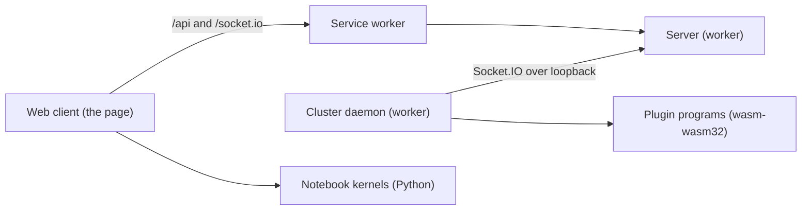

**Run in this browser** starts VOLT's server and a cluster daemon inside the tab you're looking at. They're the same programs a self-hosted deployment runs, compiled to WebAssembly, and the tab becomes its own backend: you upload trajectories, run analyses and open results without a server or anything installed.

Use it to try VOLT or for short sessions on one machine. For regular work on your own computer, the [desktop app](/docs/run/desktop) runs the same thing with storage the browser can't clear.

## Start it

<Steps>
  <Step>
    Open a VOLT web client and choose **Run in this browser** on the **Connect to a server** screen (`/connect`). A link to `/connect?run=browser` does the same in one step, as long as that browser isn't already connected to a server.
  </Step>
  <Step>
    The first time, the page reloads once. It has to be served through VOLT's service worker before it can start the stack.
  </Step>
  <Step>
    **Starting VOLT in this browser** lists the startup phases: **Start API server**, **Provision workspace** and **Start compute daemon**. **Show log** opens the stack's output.
  </Step>
  <Step>
    The dashboard opens, signed in to the workspace's local account.
  </Step>
</Steps>

On the first start, provisioning creates the local account, a team and a cluster, then waits up to two minutes for the daemon to connect. After the app opens, a default set of analysis plugins installs from the plugin registry in the background. Any that fail to install are tried again on the next start.

## What runs in the tab

- **The server and the daemon** run in workers of the page and reach each other over a loopback network inside the tab. The service worker relays the page's `/api` and `/socket.io` requests to the server, so the client talks to it as it would to a remote one.
- **Databases** are SQLite (the server's and the daemon's) and DuckDB (which analyses query), both in their WebAssembly builds.
- **Plugins** run their `wasm-wasm32` builds. The daemon reports its platform as `wasm-wasm32`, and installs ask the registry for that build.
- **Python** is CPython compiled to WebAssembly (Pyodide), available as `python3` to the daemon and to plugins written in Python.
- **Notebooks** open in VOLT's own notebook editor, with their kernels running in the page. See [Notebooks](/docs/guides/notebooks).

## Where your workspace is stored

Everything lives in the browser's origin private file system (OPFS) for the address you opened VOLT at:

| Entry | Holds |
| --- | --- |
| `volt-local-stack.json` | The provisioning state: local account, team and cluster IDs, the stack's generated secrets, the default plugin installs |
| `volt-server/`, `.volt-server-sqlite/` | The server's files and database |
| `volt-daemon/`, `.volt-daemon-sqlite/` | The daemon's files and database: trajectories, analysis results, installed plugins |
| `volt-notebooks/` | The notebook kernels' file system: one virtual environment and working directory per workspace |

The browser's local storage also keeps a flag that this address runs its own VOLT, so the next visit starts it again.

The workspace persists across reloads and browser restarts. It belongs to that address, browser and profile: another address, another browser or a private window starts a separate, empty workspace.

<Callout type="warn">
The browser can delete this storage. Clearing the site's data removes the workspace, a private window discards it when it closes, and the browser may evict it when the disk runs low, since VOLT doesn't request persistent storage. Use the [desktop app](/docs/run/desktop) or a [server](/docs/run/self-hosting) for work you need to keep.
</Callout>

## Limits

### One tab per address

Only one tab of an address can run the stack, because its workers hold the workspace's files open. A second tab stops with:

> VOLT is already running in another tab of this browser. Close it, or use that tab.

Closing the tab stops the server and the daemon, and anything running stops with them.

### Browser requirements

The stack needs service workers, Web Locks, the origin private file system and `SharedArrayBuffer`. `SharedArrayBuffer` needs a cross-origin isolated page, which the service worker provides by serving the page with `Cross-Origin-Opener-Policy: same-origin` and `Cross-Origin-Embedder-Policy: credentialless`; the browser has to support both. Browsers only allow service workers on secure origins, so the page must be served over HTTPS or from `localhost`. A client opened at a plain-HTTP LAN address can't run it.

When something is missing, startup stops with one of these:

| Message | Cause |
| --- | --- |
| This browser lacks what the local backend needs (service workers, Web Locks and the origin private file system). | One of those APIs is unavailable, often because the page isn't on HTTPS or `localhost`. |
| This browser cannot isolate the page, which the local backend needs (SharedArrayBuffer). | The page still wasn't cross-origin isolated after reloading through the service worker. |

### One user, one machine

A browser workspace runs in `local` mode: there are no other accounts, and the app hides team management, invitations, roles and sign-out (see [Deployment modes](/docs/run/configuration#deployment-modes)). Its only cluster is the tab itself, so the **Clusters** pages and **Connect new cluster** aren't offered.

### Plugins need a `wasm-wasm32` build

A plugin runs in the browser only if it publishes a `wasm-wasm32` build. Installing one that doesn't fails, because the registry has no build for this platform. The [plugin catalog](/docs/plugins) lists the published plugins.

### Python runs under Pyodide

Python is a guest of the page, so it works differently from Python on a machine:

- There's no `subprocess` and no threads.
- `python3 -m pip install` takes Pyodide's builds of packages with native code (numpy, pandas, pyarrow, scikit-learn and others) and pure-Python wheels from PyPI. The first install of a package downloads it from Pyodide's CDN.
- `requests` reaches the backends through the service worker's relay.
- `pip install voltsdk` installs the build of the Python SDK that ships with this client, not the one on PyPI. The SDK's `SpatialAssembler` isn't available, since its native extension has no Pyodide build.

### What needs the network

Installing plugins downloads them from the plugin registry, and installing Python packages downloads them from Pyodide's CDN or PyPI.

## Leave or reset

If startup fails, the screen offers **Try again** and **Connect to a server instead**. The second one stops running VOLT in this browser and opens `/connect`.

To delete the workspace and stop running VOLT at this address, clear the site's data in your browser's settings. This removes everything in the table above. The next visit shows the web client as usual, and **Run in this browser** starts a new, empty workspace.
