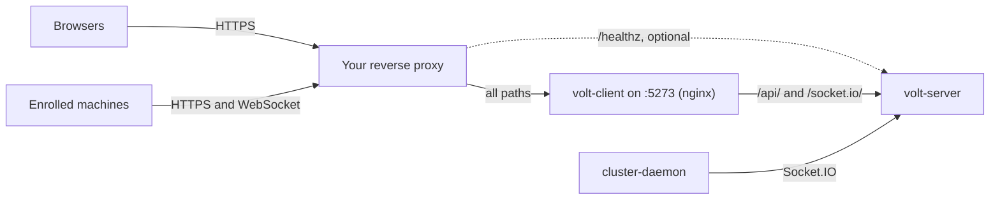

A self-hosted VOLT is a Docker Compose stack on a machine you control: PostgreSQL, the server, the web client behind nginx and, unless you choose a server-only deployment, a cluster daemon on the same machine. It runs in `cloud` mode, so people sign up, sign in and work in teams, and you can enroll more machines (workstations, servers, HPC nodes) to run their analyses.

## Requirements

- A Linux or macOS host with `bash`, `curl` and Node.js 20 or later.
- Docker with the Compose v2 plugin (`docker compose`). The Docker daemon must be running and your user must be able to use it: `docker info` has to succeed without `sudo`. On Linux, add yourself to the `docker` group (`sudo usermod -aG docker $USER`) and log in again.
- Network access to GitHub (the deploy CLI and the source of each release), to `ghcr.io` if you use prebuilt images, and to the plugin registry at `registry.voltcloud.dev`.

Building from source runs inside Docker, and the client's image compiles VOLT's WebAssembly runtime with Emscripten, so the first deployment takes a while. Prebuilt images skip that (see [Prebuilt images or building from source](#prebuilt-images-or-building-from-source)).

<Callout type="info">
The daemon on this machine runs in a Linux container and reports its platform as `linux-<arch>`. On an arm64 host it installs `linux-arm64` plugin builds, so check that the plugins you need publish one in the [plugin catalog](/docs/plugins).
</Callout>

## Deploy

Run the deploy script on the host:

```bash
curl -fsSL https://raw.githubusercontent.com/voltlabs-research/volt/main/packages/apps/desktop/scripts/deploy.sh | bash
```

<Steps>
  <Step>
    The script checks for `docker`, `node` and `curl` and that Docker answers, then downloads the deploy CLI (`cli.cjs`) and `compose.yml` from the latest GitHub release into `~/.volt-deploy`.
  </Step>
  <Step>
    The CLI asks the questions below.
  </Step>
  <Step>
    It creates a VOLT Cloud ID at `console.voltcloud.dev` with the email, username and password you entered. If that service can't be reached within 15 seconds or returns an error, the CLI skips this step and goes on.
  </Step>
  <Step>
    It downloads the source of the latest release, builds and starts the services, waits for the API, creates your account, team and cluster on the new server, starts the cluster daemon enrolled as that cluster, and waits for the web app. Each phase is printed as it runs: **Resolve sources**, **Build & start services**, **Wait for API server**, **Provision workspace**, **Start cluster daemon** and **Wait for web app**.
  </Step>
  <Step>
    It prints the client and server addresses. Open the client (`http://<host>:5273` by default) and sign in with the email and password you entered.
  </Step>
</Steps>

### What the CLI asks

| Prompt | Default | Used for |
| --- | --- | --- |
| Server host or domain | The host's first non-loopback IPv4 address | The addresses the stack advertises: `http://<host>:5273` for the client (`CLIENT_HOST`) and `http://<host>:8100` for the server (`SERVER_ENDPOINT`) |
| What do you want to deploy on this machine? | Server + cluster (daemon) | **Server only** runs no daemon here; the server has no compute until you enroll a machine |
| Full name, Email, Password | — | The first account on the server. The password needs at least 8 characters. |
| Username | — | Your VOLT Cloud ID only. Lowercase letters, digits and dashes, 2 to 39 characters. |
| Team name | — | The first team, owned by your account |
| Cluster name | — | The cluster the daemon on this machine enrolls as. It's created in server-only mode too. |
| Automatically add everyone who signs up to this team? | No | Adds every new account to your team |

### What it writes

Everything the deployment needs on the host lives in `~/.volt-deploy`:

| Path | Contents |
| --- | --- |
| `cli.cjs`, `compose.yml` | The deploy CLI and the stack's compose file, downloaded again on every run |
| `app-config.json` | The stack's variables (`env`), the deploy mode, the provisioned account, team and cluster with the daemon's credentials, and the installed release |
| `downloads/voltlabs-research/volt/` | The source of the installed release, which the images build from |

The CLI generates `SECRET_KEY` and the key that encrypts stored credentials on the first run and keeps them in `app-config.json`, along with `DEPLOYMENT_MODE=cloud`, the ports, `CLIENT_HOST` and `SERVER_ENDPOINT`. See [Configuration](/docs/run/configuration) for every variable.

<Callout type="warn">
`app-config.json` holds your account's password, the stack's secrets and the daemon's credentials in plain text. The CLI writes it readable by your user only; keep it that way and back it up. If the secrets are lost or changed, existing sessions end and the server can't decrypt the credentials it stored.
</Callout>

## The compose stack

The compose project is named `volt`, so containers are called `volt-<service>-1`.

| Service | Role | Host port |
| --- | --- | --- |
| `volt-postgres` | PostgreSQL 17. The server uses the `volt` database; the daemon creates and uses `volt-cluster`. | Not published |
| `volt-server` | The API (`/api/...`), Socket.IO (`/socket.io/`) and `/healthz` | `8100` (`SERVER_PORT`) |
| `volt-client` | The web app on nginx, which also proxies `/api/` and `/socket.io/` to the server | `5273` (`WEB_PORT`) |
| `cluster-daemon` | The cluster daemon: stores trajectories and results, runs analyses | `18080` (`DAEMON_PORT`) |

`cluster-daemon` belongs to the compose profile `enrolled`, so it only starts with `--profile enrolled`. The CLI adds that profile unless the deployment is server-only, after it has provisioned the cluster the daemon enrolls as.

Data lives in three named volumes: `volt_volt-postgres-data` (all metadata), `volt_volt-server-data` (files the server serves, such as avatars) and `volt_cluster-daemon-data` (the daemon's object store with dumps, models and results, plus its caches). The server and the daemon also mount the host's Docker socket; the daemon uses it to start containers such as notebook servers.

## Prebuilt images or building from source

By default the CLI builds the images from the release's source, and rebuilds them whenever a new release is installed.

If a `compose.images.yml` file sits next to `compose.yml`, the CLI pulls prebuilt images instead. If the pull fails, it falls back to building. `deploy.sh` only downloads `compose.yml`, so add the images file yourself:

```bash
curl -fsSL https://raw.githubusercontent.com/voltlabs-research/volt/main/packages/apps/desktop/stack/compose.images.yml \
  -o ~/.volt-deploy/compose.images.yml
```

The images are published for `linux/amd64` and `linux/arm64` on every push to `main` that changes them:

| Service | Image | Tag variable |
| --- | --- | --- |
| `volt-server` | `ghcr.io/voltlabs-research/volt-server-stack` | `VOLT_IMAGE_TAG` |
| `volt-client` | `ghcr.io/voltlabs-research/volt-client-stack` | `VOLT_IMAGE_TAG` |
| `cluster-daemon` | `ghcr.io/voltlabs-research/volt-cluster-daemon-stack` | `CLUSTER_DAEMON_IMAGE_TAG` |

Each image has a `main` tag, the default, and a `sha-<commit>` tag with the full commit hash. To pin a version, set both variables in the `env` object of `app-config.json`. The daemon image is only republished when the daemon or the SDK it uses changes, so its `sha-` tag is usually a different, older commit than the server's and client's.

Prebuilt images follow the `main` branch, while the CLI and `compose.yml` come from the latest release.

To build from a local checkout of the VOLT repository instead, add a `devMode` entry to `app-config.json` with the checkout's absolute path. Every `--update` then rebuilds from that tree and nothing is pulled from GitHub:

```json
"devMode": { "enabled": true, "voltPath": "/home/you/VOLT" }
```

## Update

Updating keeps your data: the PostgreSQL volume, the server's files and the daemon's object store.

```bash
curl -fsSL https://raw.githubusercontent.com/voltlabs-research/volt/main/packages/apps/desktop/scripts/deploy.sh | bash -s -- --update
```

`--update` compares the latest release with the installed one. If they match and the web app answers, it does nothing. Otherwise it stops the stack, downloads the new release's source, rebuilds the images (or pulls prebuilt ones), starts the stack again and signs back in to the provisioned account, so the daemon comes back as the same cluster. It never prompts, so it can run from a scheduled job.

Running the script without flags on a host that already has a deployment asks what to do: **Update — pull latest and rebuild (keeps your data)** or **Reset & re-deploy — wipe all data and start fresh**.

Pass flags after `bash -s --`:

| Flag | Effect |
| --- | --- |
| `--update` | Update to the latest release, keeping data |
| `--check` | Print the installed and the latest release and change nothing. Exits with `10` when an update is available. |
| `--server-only` | With `--update`: run the server only and stop the daemon. The mode is remembered for later updates. |
| `--with-cluster` | With `--update`: run the server and the daemon. The mode is remembered. |
| `--force` | With `--update`: go ahead even when the latest release is already installed. The stack restarts with its current images, and prebuilt images are pulled again. |
| `--data-dir <path>` | Read the deployment (`app-config.json`) from another directory |
| `-h`, `--help` | Print the usage |

| Exit code | Meaning |
| --- | --- |
| `0` | Done, or already up to date |
| `1` | The deployment failed |
| `2` | Usage error, no deployment found, or an interactive deploy without a terminal |
| `10` | An update is available (`--check`) |

`--update` and `--check` ask GitHub's API for the latest release. If you hit its rate limit, set `GITHUB_TOKEN`:

```bash
curl -fsSL https://raw.githubusercontent.com/voltlabs-research/volt/main/packages/apps/desktop/scripts/deploy.sh | GITHUB_TOKEN=<token> bash -s -- --check
```

The script itself reads a few more variables, such as `VOLT_DEPLOY_DIR` to deploy somewhere other than `~/.volt-deploy`. See [Configuration](/docs/run/configuration#deploy-script-and-cli).

## Reset or remove

To start over, run the script without flags and choose **Reset & re-deploy — wipe all data and start fresh**. The CLI asks the deploy questions again, then deletes the stack's volumes, which removes every account, trajectory and result, and deploys from scratch. It keeps the generated secrets.

To remove VOLT from the host:

```bash
docker rm -f $(docker ps -aq --filter label=com.docker.compose.project=volt)
docker volume rm volt_volt-postgres-data volt_volt-server-data volt_cluster-daemon-data
docker network rm volt_default
rm -rf ~/.volt-deploy
```

## Put it behind HTTPS

The stack serves plain HTTP on ports `5273` and `8100`. To use it beyond a trusted network, put a TLS reverse proxy in front. One upstream is enough: the client's nginx on port `5273` serves the web app and forwards `/api/` and `/socket.io/` to the server.



The proxy has to:

- **Forward WebSocket upgrades.** Socket.IO carries live updates and the daemons' connections, and notebooks reach Jupyter through `/api/jupyter/...`.
- **Accept request bodies of at least 100 MB.** Trajectories upload in parts of up to 64 MiB, and plugin archives can be up to 100 MiB. The client's nginx allows 100 MB.
- **Allow long-lived connections.** The client's nginx keeps upstream connections open for up to 24 hours.
- **Pass the `Host` header.**

`/healthz` is answered by the server only. Route it to port `8100` if people will connect to this address from another web client's `/connect` screen (see [Connect to an existing server](/docs/run#connect-to-an-existing-server)).

<Tabs items={['nginx', 'Caddy']}>
  <Tab value="nginx">
```nginx
map $http_upgrade $connection_upgrade {
    default upgrade;
    ''      close;
}

server {
    listen 443 ssl;
    server_name volt.example.org;

    ssl_certificate     /etc/ssl/volt.example.org/fullchain.pem;
    ssl_certificate_key /etc/ssl/volt.example.org/privkey.pem;

    client_max_body_size 100M;

    location / {
        proxy_pass http://127.0.0.1:5273;
        proxy_http_version 1.1;
        proxy_set_header Upgrade $http_upgrade;
        proxy_set_header Connection $connection_upgrade;
        proxy_set_header Host $host;
        proxy_set_header X-Forwarded-For $proxy_add_x_forwarded_for;
        proxy_set_header X-Forwarded-Proto $scheme;
        proxy_read_timeout 86400s;
        proxy_send_timeout 86400s;
    }

    location = /healthz {
        proxy_pass http://127.0.0.1:8100;
    }
}
```
  </Tab>
  <Tab value="Caddy">
```text
volt.example.org {
    handle /healthz {
        reverse_proxy 127.0.0.1:8100
    }
    handle {
        reverse_proxy 127.0.0.1:5273
    }
}
```

Caddy obtains the certificate and forwards WebSocket upgrades on its own, and sets no request body limit by default.
  </Tab>
</Tabs>

Then tell VOLT its public address. Set `CLIENT_HOST` and `SERVER_ENDPOINT` to the HTTPS address in the `env` object of `~/.volt-deploy/app-config.json`:

```json
"CLIENT_HOST": "https://volt.example.org",
"SERVER_ENDPOINT": "https://volt.example.org"
```

and apply it with `--update --force`:

```bash
curl -fsSL https://raw.githubusercontent.com/voltlabs-research/volt/main/packages/apps/desktop/scripts/deploy.sh | bash -s -- --update --force
```

`SERVER_ENDPOINT` has to be the address browsers and enrolled machines use: the server builds file URLs, Jupyter proxy URLs and the `VOLT_BASE_URL` notebook kernels get from it, and machines you enroll connect to it. Set it before you enroll machines, since each machine receives the address when it's installed.

Once the proxy works, block direct access to ports `5273`, `8100` and `18080` from outside. Docker publishes container ports through its own `iptables` rules, which some host firewalls (`ufw`, for one) don't filter, so check from another machine that they're closed.

## Verify it works

<Steps>
  <Step>
    The server answers its health check:

    ```bash
    curl -s http://localhost:8100/healthz
    # {"status":"ok","clientHost":"http://<host>:5273"}
    ```
  </Step>
  <Step>
    The containers are up, with `volt-volt-server-1` reported healthy:

    ```bash
    docker ps --filter label=com.docker.compose.project=volt
    ```

    You should see `volt-volt-postgres-1`, `volt-volt-server-1`, `volt-volt-client-1` and, unless the deployment is server-only, `volt-cluster-daemon-1`.
  </Step>
  <Step>
    Open the client and sign in. Your cluster shows **Connected** on the **Clusters** page.
  </Step>
  <Step>
    A new server has no plugins. Install one from the marketplace ([Plugins](/docs/guides/plugins)), upload a small trajectory ([Trajectories](/docs/guides/trajectories)) and run an analysis on it.
  </Step>
</Steps>

If the cluster stays at **Waiting for connection**, read the daemon's log with `docker logs volt-cluster-daemon-1`. The server's log is `docker logs volt-volt-server-1`.

## Enroll more machines

Any machine that can reach your server's public address can join as a cluster and run analyses: choose **Add new Cluster** on the **Clusters** page (`/dashboard/clusters`) and run the install command VOLT shows on that machine. See [Clusters](/docs/guides/clusters) for the steps and the statuses a cluster goes through.

A server-only deployment needs at least one enrolled machine before anything can be uploaded or analyzed. How enrolled machines get the daemon (built from the sources the server sends, or pulled as an image) is set by `TEAM_CLUSTER_DAEMON_DISTRIBUTION_MODE` (see [Configuration](/docs/run/configuration#server)).
